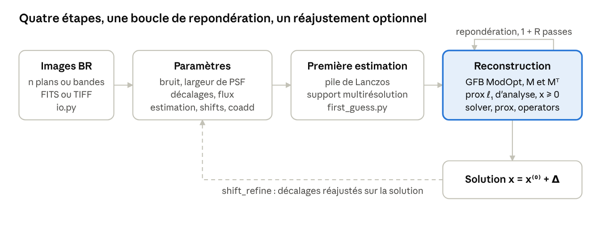
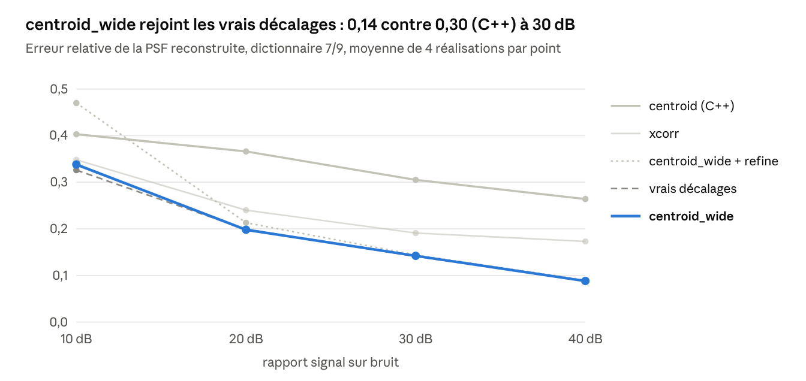

# SPRITE — document technique du portage Python

20 octobre 2026 · Olivier Amram · version 1.0

## Objet et périmètre

Ce document décrit SPRITE, une méthode de super-résolution de PSF publiée par le CEA en 2014, et son portage en Python (paquet `sprite-psf`). Le portage reproduit le code C++ d'origine à la précision float32 près, puis l'améliore :

- il corrige quatre erreurs du code d'origine ;
- il remplace l'estimateur de décalages du C++ par un estimateur sans biais de grille ;
- il traite les pixels saturés ou défectueux ;
- il estime les flux par ajustement quand ils varient entre poses ;
- il lit les images TIFF 16 bits ou float32 ;
- il fournit un outil de contrôle des reconstructions sur données réelles ;
- il reconstruit une PSF par bande à partir d'images brutes en mosaïque de Bayer (RGGB).

SPRITE (*SParse Recovery of InsTrumental rEsponse*) reconstruit une PSF à haute résolution (HR) à partir de plusieurs images à basse résolution (BR) d'une même source ponctuelle, décalées entre elles d'une fraction de pixel. Le cas d'usage d'origine est la mission Euclid, dont le détecteur échantillonne l'optique à environ 0,688 fois la fréquence de Nyquist : les étoiles y sont repliées (aliasées), alors que la mesure de cisaillement gravitationnel exige une PSF connue à mieux que quelques pour cent. Le cas d'usage visé ici dispose de nombreuses poses (jusqu'à 100) de la même étoile.

Périmètre :

- **Méthode** : algorithme 2 du papier, avec un a priori parcimonieux en analyse, une contrainte de positivité et une repondération.
- **Code de référence** : SPRITE v1.0 (CEA, octobre 2014, licence CeCILL), exécutable `run_sprite`.
- **Portage** : Python 3, numpy, scipy, astropy, tifffile, et ModOpt pour l'algorithme d'optimisation.
- **Hors périmètre** : la variation spatiale de la PSF (voir la dernière partie, pour mémoire) et les variantes secondaires de `run_sprite` (FISTA, simulation du bruit, autres premières estimations, déconvolution, pondérations spatiales).

## Organisation du dépôt

| Dossier ou fichier | Contenu | Rôle |
| --- | --- | --- |
| `sprite_c/` | code C++ SPRITE v1.0 d'origine (CEA, CeCILL), jamais modifié | archive du code publié |
| `reference/` | script de compilation du C++, programme d'export `dump_ref.cc`, données de référence `golden/` | oracle des tests : sorties du binaire d'origine, finales et intermédiaires |
| `sprite_py/` | paquet Python `sprite-psf` : code, tests, scripts de validation et leurs résultats | le logiciel à utiliser |
| `docs/` | ce document et ses figures | documentation |
| `HISTORIQUE.md` | évolutions traitées, par version | historique |
| `LICENCE.md` | licences (C++ CeCILL v2.0, Python CeCILL v2.1), références de la publication et du code publié | licence |

Le dossier `reference/` sert à prouver que le portage est fidèle. `build_reference.sh` recompile le C++ d'origine dans une copie (`sprite_c_build/`, non versionnée), l'exécute sur `cube_test.fits` avec les réglages du papier, et exporte ses résultats intermédiaires. Les fichiers de `golden/` (22 Mo, versionnés) sont ensuite comparés au Python par les tests. La reconstruction est reproductible bit à bit : on peut régénérer `golden/` à tout moment et vérifier qu'il n'a pas changé. Ce dossier n'est pas nécessaire pour utiliser `sprite-psf`, seulement pour exécuter les tests de fidélité au C++ (ils sont ignorés s'il est absent).

## Méthode publiée

SPRITE résout un problème inverse linéaire régularisé par la parcimonie de la correction à apporter à une première estimation, dans un dictionnaire d'ondelettes redondant, avec positivité et repondération (Ngolè Mboula et al. 2015, sections 2 et 3).

### Modèle d'observation

On dispose de n images BR y<sub>k</sub> de taille p₁ × p₂ d'une même étoile. La PSF recherchée x est échantillonnée d fois plus finement sur chaque axe (d = 2 par défaut). Chaque image est la PSF décalée d'une fraction de pixel, puis décimée, avec un flux et un bruit propres :

```math
y_k = f_k \, D \, H_k \, x + n_k, \qquad k = 1 \dots n
```

- **H<sub>k</sub>** : convolution par un noyau d'interpolation 2D séparable centré sur le décalage de l'image k. Le papier utilise un noyau de Lanczos, L(x) = sinc(x) sinc(x/a).
- **D** : décimation, qui garde un pixel HR sur d dans chaque direction.
- **f<sub>k</sub>** : flux photométrique relatif de l'image k (temps de pose, transparence, stabilité de la source).
- **n<sub>k</sub>** : bruit blanc gaussien d'écart type σ<sub>k</sub>.

En empilant les images blanchies (divisées par leur σ<sub>k</sub>), le terme d'attache aux données s'écrit :

```math
J_1(x) = \frac{1}{2} \sum_{k=1}^{n} \frac{\lVert y_k - f_k D H_k x \rVert_2^2}{\sigma_k^2} = \frac{1}{2} \lVert z - M x \rVert_2^2
```

M est de taille n p₁ p₂ × d² p₁ p₂. Avec n = 4 et d = 2, il y a autant d'équations que d'inconnues, mais le système est mal conditionné et bruité : il faut un a priori. La super-résolution n'est possible que si les décalages couvrent des phases sous-pixel variées : des poses toutes à la même phase ne contiennent pas plus d'information qu'une seule.

### A priori parcimonieux en analyse

La solution s'écrit x = x⁽⁰⁾ + Δ, où x⁽⁰⁾ est une première estimation. C'est la correction Δ qui est supposée parcimonieuse dans un dictionnaire Φ d'ondelettes non décimées. Le papier choisit la forme « analyse », qui pénalise directement les coefficients ΦΔ, plutôt que la forme « synthèse », qui suppose Δ combinaison de peu d'atomes. Avec la positivité de la PSF :

```math
\min_{\Delta} \; J_1\left(x^{(0)} + \Delta\right) + \kappa \left\lVert w^{(k)} \odot \lambda \odot \Phi \Delta \right\rVert_1 + \iota_{\{\Delta \ge -x^{(0)}\}}(\Delta)
```

- **λ** : niveaux de bruit attendus sur chaque coefficient. Ils sont réestimés à chaque itération par le MAD, bande par bande, de la transformée du pas de gradient.
- **κ** : seuil en nombre de « sigmas » ; c'est le principal réglage de la méthode (4 dans les expériences du papier).
- **w⁽ᵏ⁾** : poids de repondération.
- **ι** : indicatrice de la contrainte Δ ≥ −x⁽⁰⁾, c'est-à-dire x ≥ 0.

### Dictionnaires d'ondelettes : starlet et 7/9

Une transformée en ondelettes décompose une image en couches de détails à des échelles successives (1, 2, 4, 8… pixels), plus une image lissée, l'échelle grossière. Une PSF s'y décrit avec peu de coefficients significatifs : un cœur compact aux petites échelles, des anneaux et des ailes aux échelles moyennes. C'est cette parcimonie que SPRITE exploite pour séparer la PSF du bruit.

Les deux dictionnaires de SPRITE sont **non décimés** : chaque bande garde la taille de l'image. Ils sont donc redondants (plus de coefficients que de pixels) et invariants par translation : décaler l'image d'un pixel décale ses coefficients d'un pixel, sans les modifier. C'est indispensable pour une PSF dont la position sous-pixel varie, et cela évite les artefacts de bloc des transformées décimées.

| | Starlet (`-t 2`) | 7/9 non décimée (`-t 24`) |
| --- | --- | --- |
| Construction | algorithme « à trous » : lissages successifs par une B-spline cubique séparable, filtre (1, 4, 6, 4, 1)/16 dilaté d'un facteur 2 à chaque échelle | banc de filtres séparables bi-orthogonaux d'Antonini (7 et 9 coefficients), appliqués aux lignes puis aux colonnes, dilatés à chaque échelle |
| Bandes par échelle | 1, isotrope : w<sub>j</sub> = c<sub>j</sub> − c<sub>j+1</sub>, différence de deux lissages | 3, orientées : horizontale, verticale, diagonale |
| Allure des atomes | taches rondes, positives au centre, entourées d'un anneau négatif | motifs orientés selon les axes de la grille |
| Nombre de bandes (image 168 × 168, 6 échelles) | 6 | 16 |
| ‖Φ‖² (redondance effective) | 1,33 | 1,81 |
| Reconstruction | somme des bandes | banc de synthèse (filtres différents de ceux d'analyse) |
| Adjoint | différent de la reconstruction | différent de la reconstruction |
| Usage typique | objets isotropes et positifs : étoiles, galaxies (conçue pour l'astronomie) | contours et structures orientées |
| Temps (4 images 84 × 84) | 2 s | 6 s |

Pour une PSF, la starlet décrit naturellement le cœur et les anneaux ; la 7/9 décrit mieux les structures alignées sur la grille (aigrettes de diffraction d'une araignée à branches verticales ou horizontales, par exemple), mais produit des artefacts en croix sur les structures rondes. Le C++ calculait mal le prox d'analyse de la starlet (voir « Prox d'analyse : adjoint exact »). Une fois corrigée, la starlet égale la 7/9 de 20 à 40 dB, fait mieux à faible SNR et tourne 3 fois plus vite : c'est le dictionnaire par défaut depuis le 18 octobre 2026.

### Repondération

La norme ℓ₁ biaise les gros coefficients. SPRITE applique la repondération de Candès, Wakin et Boyd (2008) : après chaque résolution, les poids deviennent

```math
w_j^{(k+1)} = \frac{1}{1 + \lvert \alpha_j^{(k)} \rvert / (3 \sigma_j)}, \qquad \alpha^{(k)} = \Phi \Delta^{(k)}
```

Les coefficients significatifs sont ainsi moins pénalisés à la passe suivante. Par défaut, une passe initiale est suivie d'une passe repondérée.

### Algorithme : forward-backward généralisé

Le problème est la somme d'un terme différentiable (J₁) et de deux termes non lisses (ℓ₁ pondérée, positivité). SPRITE le résout par le forward-backward généralisé de Raguet, Fadili et Peyré (2013), avec deux variables auxiliaires z₁ et z₂ et des poids ω₁ = ω₂ = 0,5 :

```math
\begin{aligned}
z_i &\leftarrow z_i + \lambda \left( \operatorname{prox}_{\frac{\mu}{\omega_i} g_i}\!\left( 2\Delta - z_i - \mu \nabla J_1(x^{(0)} + \Delta) \right) - \Delta \right), \quad i = 1, 2 \\
\Delta &\leftarrow \omega_1 z_1 + \omega_2 z_2
\end{aligned}
```

- **Pas** : μ = 1/ρ(MᵀM), le rayon spectral étant estimé par la méthode de la puissance.
- **Relaxation** : λ = 1,4.
- **Prox de la positivité** : projection Δ ← max(Δ, −x⁽⁰⁾).
- **Prox de l'ℓ₁ d'analyse** : il n'a pas de forme close, car Φ est redondant. Il se calcule par un FISTA sur le problème dual (seuillage doux, puis projection sur une boule ℓ∞ pondérée), qui utilise l'adjoint Φᵀ : 100 sous-itérations au premier appel, puis 5 avec démarrage à chaud.

### Estimation des paramètres

Tout est estimé automatiquement à partir des images BR (section 3.4.1 du papier) :

- **Bruit σ<sub>k</sub>** : MAD de la première bande de détails d'une transformée 7/9, divisé par 0,6745.
- **Décalages** : différences de centroïdes entre chaque image et l'image de référence, calculés sur les images seuillées à min(4σ<sub>k</sub>, (max|y<sub>k</sub>|/σ<sub>k</sub> − 1)σ<sub>k</sub>), avec la pondération gaussienne itérative de Baker et Moallem (2007).
- **Flux** : intégrale dans une ouverture circulaire centrée sur le centroïde.
- **Première estimation x⁽⁰⁾** : shift-and-add des images interpolées par Lanczos (médiane), puis débruitage par seuillage dur à 5σ par échelle (section 3.4.2). Comme x⁽⁰⁾ n'est pas régularisée, ses défauts passent dans la solution : elle doit être propre.

Coût annoncé dans le papier : O(n p₁ p₂ d² log(p₁ p₂ d²)), soit environ 60 s pour quatre images 84 × 84 en 2014.

## Implémentation Python

Le paquet `sprite-psf` reprend la structure de l'algorithme 2, avec un module par brique ; seul l'algorithme d'optimisation est délégué à ModOpt.

| Module | Rôle | Équivalent C++ |
| --- | --- | --- |
| `io.py` | lecture FITS et TIFF, cartes de pixels défectueux, écriture, fond de bord | `io_3d_read_data` |
| `wavelets.py` | starlet, 7/9 non décimée (transformée, reconstruction, adjoint), MAD iSAP | `MR_Trans`, `SB_Filter`, `get_sigma_mad` |
| `operators.py` | noyaux de Lanczos, M et Mᵀ par FFT, rayon spectral | `sprite_op_mat`, `sprite_transp_op_mat`, `spectral_rad_est` |
| `estimation.py` | bruit, centroïdes, flux (ouverture et ajustement) | `noise_est`, `compute_centroid`, `flux_est` |
| `shifts.py` | estimateurs de décalage, réajustement sur un modèle | `shift_est` |
| `masking.py` | pixels saturés (censurés) et défectueux (exclus), interpolation harmonique | (aucun) |
| `coadd.py` | largeur de la PSF : co-addition iSAP puis ajustement gaussien | `lr_psf_size`, `coadd_frames` |
| `first_guess.py` | shift-and-add de Lanczos, filtrage par support multirésolution | `mod_gen_2`, `mr_support_filt` |
| `prox.py` | prox ℓ₁ d'analyse pondéré (FISTA dual), contrainte Δ ≥ −x⁽⁰⁾ | `wl_filter_analysis`, `ineq_cons` |
| `solver.py` | algorithme 2, configuration, réajustements | `Sprite::min2`, `do_it` |
| `bayer.py` | mosaïque de Bayer : découpage par sous-réseau, décalages communs, une reconstruction par bande | (aucun) |
| `metrics.py` | FWHM, ellipticités, comparaison de PSF | (aucun) |
| `diagnostics.py` | contrôles sur données réelles, monochromes et Bayer | (aucun) |
| `parallel.py` | répartition des reconstructions indépendantes sur plusieurs processus | (aucun) |
| `cli.py` | commandes `sprite-psf` et `sprite-psf-check` | `run_sprite` |



Les paramètres sont estimés une fois sur les images BR. La reconstruction enchaîne la première passe et les passes repondérées ; en option, flux ou décalages sont réajustés sur la solution avant une nouvelle reconstruction.

### Optimisation avec ModOpt

La classe `GenForwardBackward` de ModOpt 1.7 implémente exactement l'itération de Raguet et al. utilisée par le C++ : même variable z<sub>i</sub>, même facteur γ/ω<sub>i</sub> passé au prox, même moyenne pondérée. Le portage lui fournit trois objets :

- **`SpriteGradient`** (`GradParent`) : résidu blanchi et gradient −Mᵀ(z − M(x⁽⁰⁾ + Δ)), avec poids nul sur les pixels exclus et terme censuré sur les pixels saturés.
- **`AnalysisL1Prox`** (`ProximityParent`) : prox de l'ℓ₁ d'analyse. Il réestime les niveaux de bruit λ à partir du gradient courant, garde la variable duale d'un appel à l'autre (démarrage à chaud) et porte les poids de repondération.
- **`LowerBoundProx`** (`ProximityParent`) : projection sur Δ ≥ −x⁽⁰⁾.

Une sous-classe de `GenForwardBackward` ajoute le critère d'arrêt à fenêtre glissante : arrêt quand la moyenne de Σ|Δ<sub>n+1</sub> − Δ<sub>n</sub>| sur 25 itérations passe sous 0,005 × Σ|Δ<sub>n</sub>|. Les variables z<sub>i</sub> sont conservées entre les passes de repondération.

### Choix d'implémentation

- **Transformées** : réécrites en numpy ; chaque filtrage 1D est une matrice mise en cache, appliquée par produit matriciel. Elles reproduisent les conventions iSAP (bord constant pour la starlet, bord miroir et filtres normalisés en ℓ₁ pour la 7/9, ordre des bandes). Chacune fournit sa reconstruction et son adjoint exact, bords compris.
- **Convolutions** : par FFT, sur une grille périodique, avec un noyau normalisé à une somme unité et centré sur N/2, comme `psf_convol`. Le test d'adjoint ⟨Mx, y⟩ = ⟨x, Mᵀy⟩ tient à 10⁻¹⁵.
- **Médiane** : la médiane inférieure d'iSAP pour un effectif pair, qui compte pour le MAD et pour la pile d'images.
- **Orientation** : le C++ travaille sur les images transposées ; le portage travaille dans l'orientation naturelle des tableaux, et les décalages sont notés (dy, dx).
- **Précision** : float64 partout, contre float32 en stockage dans le C++.
- **Parallélisme** : les reconstructions indépendantes (bandes d'une mosaïque, blocs de la prédiction croisée, moitiés, valeurs d'un balayage) sont réparties sur des processus (`concurrent.futures`), chacun limité à un thread de calcul numérique pour éviter la sur-souscription des cœurs. Option `-j` (défaut : cœurs moins un) ; `-j 1` exécute tout dans le processus courant. Les résultats sont identiques à l'exécution séquentielle. Une reconstruction seule n'est pas parallélisée.
- **Code** : toutes les fonctions et classes sont typées (`numpy.typing`) et documentées par des docstrings au format numpy, en français (paramètres, retours, exceptions, formes des tableaux).

Deux écarts volontaires au C++ subsistent, sans effet pratique :

- **Rayon spectral** : la méthode de la puissance part d'un vecteur numpy à graine fixe au lieu de `rand()`, d'où un écart relatif de 7×10⁻⁵.
- **Largeur de la PSF** : elle est ajustée par moindres carrés au lieu du schéma de Newton alterné, d'où un écart relatif de 1,1×10⁻⁴ et un effet de 2×10⁻⁵ pixel sur les centroïdes.

Temps de calcul : environ 2 s en starlet et 6 s en 7/9 pour 4 images de 84 × 84 (solution 168 × 168), contre 6 s et 24 s pour le C++ ; le temps croît ensuite linéairement avec le nombre d'images (environ 15 s pour 100 images).

## Contrôle du portage

En mode de rétrocompatibilité, le portage reproduit le binaire C++ à 10⁻⁶ près sur la solution finale, et chaque étage intermédiaire est vérifié séparément ; 71 tests automatiques couvrent le portage et les évolutions, soit 97 % des lignes du paquet (les lignes non couvertes sont surtout des messages d'erreur).

### Référence C++

Le script `reference/build_reference.sh` recompile le code d'origine sur macOS dans une copie, avec trois correctifs de compilation sans effet numérique :

- dialecte C++98 et OpenMP via libomp ;
- setters `std::complex` dans un lecteur FITS que SPRITE n'utilise pas ;
- renommage d'une variable globale en conflit avec `std::transform`.

Il exécute ensuite les deux configurations du papier sur `cube_test.fits` (`-t 2` et `-t 24`, avec `-s 4 -r 2 -F -N`). Un programme d'export (`dump_ref.cc`), lié aux bibliothèques d'origine, écrit les résultats intermédiaires. Deux reconstructions complètes produisent des fichiers identiques bit à bit (103 fichiers, vérification MD5).

### Écarts mesurés au C++

| Étage | Écart max relatif |
| --- | --- |
| Starlet et 7/9 : coefficients et reconstruction | ≤ 2×10⁻⁷ |
| Convolution, décimation, opérateurs M et Mᵀ | ≤ 2,5×10⁻⁷ |
| Bruit, centroïdes, flux, co-addition | ≤ 6×10⁻⁷ |
| Première estimation x⁽⁰⁾ | 3,5×10⁻⁷, supports identiques |
| Solution finale, starlet et 7/9, valeurs C++ injectées | ≤ 1,1×10⁻⁶ |
| Solution finale, pipeline Python autonome | 8×10⁻⁵ |

Ces écarts correspondent à la précision float32 du C++. La ligne « valeurs injectées » fixe le rayon spectral et la largeur de la PSF à ceux du C++, pour isoler l'algorithme ; la ligne autonome inclut les deux écarts volontaires.

Les autres tests couvrent :

- la reconstruction parfaite et l'adjoint exact des transformées ;
- l'identité d'adjoint de M ;
- le recalage des images par la pile corrigée ;
- l'égalité des flux d'une même source placée à différentes phases, et l'ajustement exact des flux ;
- la lecture des formats TIFF et FITS ;
- la précision des estimateurs de décalage ;
- les masques : deux jeux de données qui ne diffèrent que sur des pixels exclus donnent exactement la même solution ;
- l'absence de fond avec la starlet corrigée ;
- l'outil de contrôle sur données réelles et le balayage de paramètres ;
- la mosaïque de Bayer : découpage, convention des sous-réseaux, décalage chromatique retrouvé, réajustement exact des décalages sur les PSF vraies, options (fond, pixels défectueux, flux, motif BGGR) ;
- les options du solveur (réajustements, `xcorr`, flux par ajustement, flux et décalages imposés) ;
- la ligne de commande : toutes les sorties de `-W`, `-S`, `--bayer`, `sprite-psf-check` et `--scan`.

### Validation sur données simulées

Le script `validation/synthetic.py` suit le protocole du papier (section 4) :

- **PSF** : pupille obscurcie (30 %), araignée à trois branches et aberrations de bas ordre aléatoires, échantillonnée à 2 × 0,688 × Nyquist sur 168 × 168 pixels.
- **Images BR** : copies décalées par une rampe de phase exacte dans la pupille, puis décimées d'un facteur 2. Le modèle de simulation diffère ainsi de celui de SPRITE, ce qui évite le crime inverse.
- **Bruit** : bruit blanc gaussien, de niveau fixé par le rapport signal sur bruit en dB défini ci-dessous.
- **Métriques** : erreur relative ‖x̂ − x‖/‖x‖ après normalisation en flux, erreurs absolues sur les ellipticités e₁ et e₂ (moments pondérés, éq. 27–29), erreur relative de FWHM (ajustement d'une lorentzienne modifiée).

Les simulations n'incluent ni la réponse du pixel, ni le bruit de photons de l'étoile. Les résultats chiffrés de ce document en dépendent ; la validation sur données réelles reste à faire (voir « Mise en œuvre sur données réelles »).

### Rapport signal sur bruit en dB

Les niveaux de bruit (10, 20, 30, 40 dB) suivent la définition du papier (section 4.2). C'est un rapport signal sur bruit en échelle logarithmique, mais un rapport de **variances**, avec un « signal » particulier :

```math
\mathrm{SNR}_{\mathrm{dB}} = 10 \log_{10} \frac{\operatorname{Var}\left(x_{\mathrm{HR}}\ \text{sur 50 × 50 pixels autour du lobe central}\right)}{\sigma^2}
```

- **Signal** : la variance empirique de la PSF HR vraie dans une fenêtre de 50 × 50 pixels HR centrée sur le pic. Ce n'est ni le pic ni le flux de l'étoile.
- **Bruit** : σ², la variance du bruit blanc ajouté à chaque image BR ; il représente ensemble le bruit de lecture, le bruit du fond et, en première approximation, le bruit de photons.
- **Échelle** : 10 log₁₀ d'un rapport de variances, soit 20 log₁₀ d'un rapport d'écarts types ; +20 dB divisent σ par 10.

**Interprétation.** Un faible SNR en dB correspond à une étoile faible devant son bruit : étoile peu lumineuse, ou fond et bruit de lecture importants. Un SNR élevé correspond à une étoile lumineuse devant un bruit modéré. Seul compte le rapport : une étoile faible sur un fond très calme et une étoile brillante sur un fond bruité peuvent avoir le même SNR. Dans un détecteur réel, le bruit de photons de l'étoile croît avec son flux : doubler le flux ne double pas le rapport, et le bruit n'est plus uniforme (plus fort au cœur), ce que les simulations ne représentent pas.

La fenêtre de 50 × 50 pixels contient surtout du fond : sa variance est faible devant le carré du pic, si bien que ces dB sous-estiment fortement les rapports signal sur bruit usuels en astronomie. Équivalences pour les PSF simulées (moyenne sur 10 PSF, `validation/results/masking_and_snr.txt`) :

| SNR (dB) | Pic / σ dans une image BR | SNR en filtre adapté, une image | SNR en filtre adapté, 4 images |
| --- | --- | --- | --- |
| 10 | 77 | 85 | 169 |
| 20 | 243 | 268 | 536 |
| 30 | 768 | 847 | 1 693 |
| 40 | 2 430 | 2 677 | 5 355 |

Le SNR en filtre adapté est √(Σ y²)/σ sur les pixels de l'image sans bruit : c'est le SNR d'une photométrie par ajustement de PSF optimal. Même 10 dB correspondent donc à une étoile brillante (pic 77 fois au-dessus du bruit). Une étoile de SNR intégré 50 à 100 se situe vers 5 à 10 dB, sous la plage testée.

### Erreurs du C++ corrigées

La comparaison au binaire d'origine, étage par étage, a mis au jour quatre erreurs du code C++. Elles sont corrigées par défaut ; les options de rétrocompatibilité (voir « Rétrocompatibilité avec le C++ publié ») les reproduisent une à une.

1. **Recalage de la première estimation** (`lanczos_stacking`) : chaque image est rééchantillonnée au décalage opposé et sur l'axe permuté. Sur `cube_test.fits`, l'erreur de recalage atteint 0,9 pixel BR ; comme la parcimonie porte sur Δ = x − x⁽⁰⁾, elle biaise directement la solution.
2. **Ouverture de flux** (`flux_est`) : des indices de pixels comptés à partir de 0 sont comparés à des centroïdes comptés à partir de 1 ; l'ouverture est décalée d'un pixel sur chaque axe, soit 1,4 pixel en diagonale pour un rayon de 2 à 3 pixels.
3. **Critère d'arrêt** (`min2`) : la moyenne glissante retire un élément encore présent dans la fenêtre, et le tampon n'est pas remis à zéro entre les passes.
4. **Prox d'analyse** (`wl_filter_analysis`) : la reconstruction de la transformée remplace son adjoint dans le calcul dual. Corrigé pour la starlet ; conservé pour la 7/9, où il donne de meilleurs résultats.

Deux autres défauts du C++ sont sans incidence sur les résultats : `noise_est_trace` est écrit hors limites, et le chemin du fichier `lr_` est construit sans séparateur.

## Utilisation

SPRITE s'utilise par la fonction Python `sprite()` ou par la commande `sprite-psf` ; la commande `sprite-psf-check` contrôle une reconstruction sur données réelles.

### Installation

```bash
cd sprite_py
python -m venv .venv && .venv/bin/pip install -e ".[test]"
.venv/bin/python -m pytest          # 71 tests, environ 1 min 30
.venv/bin/python -m pytest --cov=sprite --cov-report=term-missing   # couverture par module
```

Dépendances : numpy, scipy, astropy, modopt, tifffile.

### API Python

```python
from sprite import sprite
from sprite.io import load_frames, load_bad_pixels

frames, dtypes = load_frames("images/*.tif")          # (n, ny, nx), float64
res = sprite(frames, estimate_noise_per_frame=True,
             subtract_background=True, saturation=65000,
             bad_pixels=load_bad_pixels("defauts.tif"))
res.solution        # PSF HR, (2 ny, 2 nx), alignée sur l'image de référence
res.shifts          # décalages (dy, dx) en pixels HR, image 0 = référence
res.flux, res.sigma # flux relatifs, bruit par image
res.residual        # résidu BR en unités des données (nul sur les pixels exclus)
res.valid, res.censored   # pixels valides, pixels saturés
```

La solution somme approximativement au flux de l'image de référence (`ref_frame`, 0 par défaut).

### Ligne de commande

```bash
# données réelles, réglages par défaut (starlet, kappa 4, centroid_wide)
sprite-psf -N --background --saturation 65000 --bad-pixels defauts.tif images/*.tif psf.tif sorties/

# même chose avec flux variables entre poses
sprite-psf -N -F --flux-method fit --flux-refine 3 --background images/*.tif psf.tif sorties/

# contrôle de la reconstruction (mêmes options, sans fichier de sortie)
sprite-psf-check -N --background --saturation 65000 --bad-pixels defauts.tif images/*.tif

# balayage de kappa par validation croisée
sprite-psf-check -N --background --scan kappa 2 3 4 5 6 8 images/*.tif

# images brutes en mosaïque de Bayer RGGB (non dématricées) : une PSF par bande
sprite-psf -N --bayer RGGB --background images/*.tif psf.tif sorties/

# contrôle d'une reconstruction Bayer (blocs et moitiés formés de poses entières)
sprite-psf-check -N --bayer RGGB --background images/*.tif

# configuration du papier reproduite à l'identique, erreurs du C++ comprises
sprite-psf -t 2 -s 4 -F -N --cpp-compat --cpp-orientation cube_test.fits solution.fits sorties/
```

Sorties de `sprite-psf` dans le dossier indiqué :

- la solution, au format de l'extension du fichier (`.fits` ou `.tif`, float32) ;
- `lr_<nom>` : les images BR prédites par la solution ;
- avec `-w fichier` : les résidus BR ;
- avec `-W` : les diagnostics, au format du C++ : `model` (première estimation), `pixel_map` (1 valide, 2 saturé, 0 exclu), `centroids.txt`, `shift.txt` (pixels HR, colonnes x puis y), `flux.txt` (flux relatifs, une ligne par image, réutilisable par `--fluxes`), `sig_est.txt`, `mse.txt`, `background.txt`, `param.txt`.

### Formats d'entrée

Chaque plan ou bande est une image BR. Les entrées acceptées sont :

- un cube FITS (n, ny, nx) ;
- un TIFF multipage ;
- un TIFF dont les échantillons par pixel ou les canaux sont les bandes ;
- plusieurs fichiers d'une image chacun, donnés en liste, en dossier ou par motif, et lus dans l'ordre.

Les échantillons TIFF peuvent être des entiers non signés 16 bits ou des flottants 32 bits ; les autres types entiers et flottants sont aussi acceptés. Tout est converti en float64. Les images doivent avoir la même taille et montrer la même étoile, à peu près centrée.

## Paramètres

Les paramètres sont regroupés par thème, de la même façon dans `SpriteConfig` (API) et dans l'aide de `sprite-psf`. La rétrocompatibilité, qui reproduit des erreurs du C++, est séparée du reste.

### Paramètres principaux

| Paramètre | Option CLI | Défaut | Conseillé | Rôle |
| --- | --- | --- | --- | --- |
| `transform` | `-t` | `starlet` (2) | `starlet` | dictionnaire d'ondelettes, voir « Dictionnaires d'ondelettes » |
| `kappa` | `-s` | 4 | 4, à confirmer par balayage | seuil de parcimonie en écarts types ; plus grand = solution plus lisse |
| `estimate_noise_per_frame` | `-N` | non | oui | bruit estimé image par image ; sinon, bruit maximal pour toutes |
| `upfact` | `-r` | 2 | 2 | facteur de sur-échantillonnage |

Depuis le 18 octobre 2026, les défauts sont les réglages mesurés comme les meilleurs ; `run_sprite` utilisait la 7/9 et κ = 3. `-N` n'est pas activé par défaut, comme dans `run_sprite`, mais il est conseillé dès que le bruit peut varier d'une pose à l'autre. κ se règle sur les données par balayage (voir « Converger vers le meilleur réglage »).

### Décalages

| Paramètre | Option CLI | Défaut | Rôle |
| --- | --- | --- | --- |
| `shift_method` | `--shift-method` | `centroid_wide` | estimateur : `centroid_wide`, `centroid` (méthode du papier, biaisée) ou `xcorr` |
| `wide_factor` | `--wide-factor` | 2,5 | fenêtre de `centroid_wide`, en largeurs de PSF |
| `shifts` | `-S` | estimés | décalages connus (fichier : une ligne `sx sy` par image, pixels BR) |
| `shift_refine` | `--shift-refine` | 0 | réajustements des décalages sur la solution (déconseillé, voir « Estimation des décalages ») |

### Flux

| Paramètre | Option CLI | Défaut | Rôle |
| --- | --- | --- | --- |
| `estimate_flux` | `-F` | non | estime les flux relatifs ; à n'utiliser que s'ils varient de plus de 3 % entre poses |
| `flux_method` | `--flux-method` | `aperture` | avec `-F` : `fit` (conseillé) ou `aperture` (méthode du papier) |
| `flux_refine` | `--flux-refine` | 0 | avec `-F` : réajustements sur la solution (3 conseillés) |
| `fluxes` | `--fluxes` | aucun | flux relatifs connus, une valeur par image ; prioritaires sur `-F` |

### Fond et pixels

| Paramètre | Option CLI | Défaut | Rôle |
| --- | --- | --- | --- |
| `subtract_background` | `--background` | non | soustrait la médiane de la bordure de chaque image |
| `saturation` | `--saturation` | aucune | niveau de saturation (données brutes) ; pixels traités comme bornes inférieures |
| `bad_pixels` | `--bad-pixels` | aucune | carte des pixels défectueux (non nul = défectueux) |
| `mask_dilate` | `--mask-dilate` | 0 | couronne exclue autour des zones saturées ou défectueuses, en pixels |

### Mosaïque de Bayer

| Paramètre | Option CLI | Défaut | Rôle |
| --- | --- | --- | --- |
| `pattern` (API `sprite_bayer`) | `--bayer` | aucun | motif de la mosaïque (`RGGB`, `BGGR`, `GRBG`, `GBRG`) ; active la reconstruction par bande |
| `upfact` | `-r` | 2 | facteur par rapport au pixel du détecteur, comme en monochrome |
| `pose_shifts` (API) | `-S` | estimés | décalages connus entre poses (fichier : une ligne `sx sy` par pose, pixels du détecteur) |
| `pose_refine` (API) | | 2 si ≥ 50 poses, sinon 0 | réajustements des décalages sur les PSF reconstruites |

### Exécution

| Paramètre | Option CLI | Défaut | Rôle |
| --- | --- | --- | --- |
| `n_jobs` (API `check`, `check_bayer`, `scan`, `sprite_bayer`) | `-j`, `--jobs` | cœurs moins un | nombre de processus pour les reconstructions indépendantes ; `1` pour tout exécuter dans le processus courant |

### Algorithme (avancé)

| Paramètre | Option CLI | Défaut | Rôle |
| --- | --- | --- | --- |
| `exact_adjoint` | `--prox-backprojection` | auto | prox d'analyse : adjoint exact ou reconstruction ; auto = adjoint pour la starlet, reconstruction pour la 7/9 (voir « Prox d'analyse : adjoint exact ») |
| `n_scales` | `-n` | ⌊log₂ N<sub>HR</sub>⌋ − 1 | nombre d'échelles des ondelettes |
| `n_iter` | `-i` | 50 | itérations maximales par passe |
| `n_reweight` | `-R` | 1 | passes de repondération après la première |
| `cv_win`, `cv_tol` | `-C`, `-a` | 25, 0,005 | critère d'arrêt à fenêtre glissante |
| `w1`, `relax` | (API) | 0,5, 1,4 | poids et relaxation du forward-backward généralisé |
| `lanczos_radius` | (API) | 10 | rayon des noyaux de recalage de l'opérateur |
| `first_guess_nsig` | (API) | 5 | seuil du débruitage de la première estimation |
| `shift_nsig` | (API) | 4 | seuil de bruit pour l'estimation des décalages |
| `ref_frame` | (API) | 0 | image de référence (décalage nul, flux 1) |
| `psf_sigma`, `spectral_radius` | (API) | estimés | imposent la largeur de PSF ou le rayon spectral |

### Rétrocompatibilité avec le C++ publié

Ces options reproduisent des **erreurs** du code d'origine, pour retrouver ses résultats à l'identique (comparaison avec le papier, non-régression). Elles ne doivent pas servir à des mesures.

| Paramètre | Option CLI | Erreur reproduite |
| --- | --- | --- |
| `cpp_compat` | `--cpp-compat` | les quatre erreurs de « Erreurs du C++ corrigées », plus l'estimateur de décalages `centroid` du papier |
| `compat_stack` | `--cpp-compat-stack` | recalage de la première estimation au décalage opposé, sur les axes permutés |
| `compat_flux` | `--cpp-compat-flux` | ouverture de flux décalée d'un pixel sur chaque axe ; empilement des images sans correction de flux |
| `compat_stopping` | `--cpp-compat-stopping` | moyenne glissante du critère d'arrêt mal mise à jour |
| (par `cpp_compat`) | `--cpp-compat` | reconstruction à la place de l'adjoint dans le prox d'analyse, y compris pour la starlet |
| (sorties) | `--cpp-orientation` | images 2D écrites transposées |

`--cpp-compat` ne change pas le dictionnaire ni κ : pour retrouver exactement une commande `run_sprite`, reprendre ses options (`-t 24 -s 3` pour ses valeurs par défaut, `-t 2 -s 4` ou `-t 24 -s 4` pour les commandes du papier).

Les méthodes du papier qui ne sont pas des erreurs, mais simplement moins bonnes, restent des options ordinaires : `--shift-method centroid`, `--flux-method aperture`, et la reconstruction dans le prox pour la 7/9, conservée par défaut parce qu'elle y donne de meilleurs résultats.

## Traitement des données

### Soustraction du fond

Avec `--background` (API : `subtract_background=True`), chaque image perd une constante : la médiane des pixels valides de sa bordure. La soustraction précède toute autre étape, y compris l'estimation du bruit.

- **Bordure** : bande de `w` pixels le long des quatre côtés, avec `w` = 10 % du plus petit côté de l'image, et au moins 2 pixels. Pour une image de 84 × 84, `w` = 8, soit 2 432 pixels sur 7 056.
- **Estimateur** : la médiane, qui ignore les quelques pixels chauds ou rayons cosmiques présents dans la bordure ; les pixels saturés ou défectueux n'y entrent pas.
- **Indépendance** : une valeur par image, car l'offset peut varier d'une pose à l'autre.
- **Trace** : les valeurs soustraites sont renvoyées dans `res.background` et écrites dans `background.txt` avec `-W`.

La méthode suppose un fond uniforme sur l'image, une bordure sans flux de l'étoile et un bruit de fond symétrique. Pour des vignettes serrées ou un fond non uniforme, un fond mesuré sur des poses sombres ou une région vide du détecteur reste préférable ; il se soustrait avant l'appel à `sprite()`.

### Pixels saturés ou défectueux

Un pixel défectueux est exclu de l'attache aux données ; un pixel saturé y reste, comme borne inférieure. Un pixel défectueux ne porte aucune information ; un pixel saturé dit que la vraie valeur est au moins égale au niveau de saturation. Avec r = y − M(x⁽⁰⁾ + Δ) le résidu blanchi :

```math
J_1 = \frac{1}{2} \sum_{\text{valides}} r^2 + \frac{1}{2} \sum_{\text{saturés}} \max(r, 0)^2
```

- **Pixels défectueux** : carte fournie (`--bad-pixels`, FITS ou TIFF, commune à toutes les images ou une par image) et valeurs non finies. Poids nul : la solution ne dépend pas de leur valeur.
- **Pixels saturés** : valeur brute ≥ `--saturation`. Le terme censuré ne pénalise le modèle que s'il passe sous la valeur mesurée. Il reste convexe et dérivable, de gradient lipschitzien de même constante : l'algorithme et son pas sont inchangés.
- **Couronne** (`--mask-dilate N`) : les pixels à moins de N pixels d'une zone saturée ou défectueuse sont exclus (débordement de charge, diaphonie).
- **Estimations préalables** (bruit, largeur de PSF, décalages, flux, première estimation) : elles demandent des images complètes. Les pixels exclus y sont remplacés par une interpolation harmonique (moyenne itérée des voisins, exacte sur une variation linéaire) ; les pixels saturés gardent leur valeur écrêtée. L'interpolation n'entre jamais dans l'attache aux données.

Résultats sur données simulées (30 dB, dictionnaire 7/9, 3 réalisations, `validation/results/masking_and_snr.txt`) :

| Cas | Erreur relative | Erreur de FWHM |
| --- | --- | --- |
| Données propres | 0,099 | 1,2 % |
| 0,3 % de pixels chauds (+50 σ), sans carte | 0,504 | 1,1 % |
| 0,3 % de pixels chauds, avec carte | 0,099 | 1,2 % |
| Saturation à 80 % du pic (5 pixels), non signalée | 0,257 | 15,1 % |
| Saturation à 80 % du pic, pixels exclus (poids nul) | 0,586 | 68,1 % |
| Saturation à 80 % du pic, terme censuré (retenu) | 0,236 | 12,4 % |

Les pixels défectueux sont entièrement neutralisés. Pour la saturation, exclure les pixels est pire que ne rien faire, car plus rien ne contraint la hauteur du pic ; le terme censuré améliore le résultat sans le ramener au niveau des données propres. Un pic saturé dans toutes les images reste une perte d'information : mieux vaut des poses plus courtes.

## Estimation des décalages

`centroid_wide`, l'estimateur par défaut, donne de 20 à 40 dB la même qualité de reconstruction que les vrais décalages, et divise l'erreur relative par 2 à 3 par rapport au centroïde du papier.

### Le problème

Le papier pondère le centroïde par une gaussienne de largeur σ<sub>PSF</sub>, soit 0,5 à 0,7 pixel BR. Sur une PSF sous-échantillonnée, une fenêtre aussi étroite se verrouille sur la grille des pixels : même sans bruit, le rapport entre décalage estimé et décalage vrai varie de 0,7 à 1,1. L'erreur RMS atteint 0,21 à 0,25 pixel HR quel que soit le bruit. Or le modèle M et la première estimation reposent sur ces décalages.

### Options

| Option | Principe | Coût |
| --- | --- | --- |
| `centroid` | centroïde pondéré du papier, fenêtre σ<sub>PSF</sub> | négligeable |
| `centroid_wide` (défaut) | même estimateur, fenêtre `wide_factor` × σ<sub>PSF</sub> (2,5) | négligeable |
| `xcorr` | corrélation croisée avec l'image de référence, affinée au 1/100 de pixel par DFT (Guizar-Sicairos 2008), sur images seuillées | 10 ms |
| `shift_refine` | après une reconstruction, ajuste décalages et flux de chaque image sur la solution, puis relance | une reconstruction par tour |

Une autre piste a été testée puis écartée : ajuster les décalages sur la pile de Lanczos. Construite à partir d'images repliées, cette pile est fausse, et l'ajustement absorbe ses erreurs (décalages presque exacts dégradés de 0,001 à 0,08–0,10 pixel HR).

La largeur de fenêtre a été réglée sur 10 réalisations par niveau de bruit : un facteur 2 est le meilleur à 10–20 dB, un facteur 3 à 30–40 dB ; 2,5 reste à moins de 0,003 pixel HR de l'optimum de 20 à 40 dB (`validation/results/wide_factor.txt`).

### Résultats

Protocole : validation sur données simulées, 4 images, dictionnaire 7/9, `-s 4 -N`, flux égaux non estimés, 4 réalisations par niveau de bruit (`validation/shifts_benchmark.py`).



| Méthode | Erreur RMS des décalages à 20 / 30 / 40 dB (pixels HR) | Erreur de FWHM à 30 / 40 dB |
| --- | --- | --- |
| `centroid` (papier) | 0,239 / 0,226 / 0,210 | 9,9 % / 2,5 % |
| `centroid_wide` | 0,027 / 0,007 / 0,004 | 6,1 % / 2,4 % |
| `xcorr` | 0,103 / 0,121 / 0,109 | 6,6 % / 1,4 % |
| `centroid_wide` + `shift_refine` | 0,066 / 0,011 / 0,010 | 6,2 % / 2,4 % |
| vrais décalages | 0 | 6,1 % / 2,5 % |

- **`centroid_wide`** supprime le verrouillage sans coût ; à 30 dB, son erreur de décalage (0,007 pixel HR) n'a plus d'effet mesurable.
- **`xcorr`** est exact sur des images bien échantillonnées, mais garde un biais d'environ 0,11 pixel HR sur des images repliées.
- **`shift_refine`** n'apporte rien : image et décalages sont partiellement dégénérés, et la solution absorbe une partie de l'erreur. À 10 dB, il dégrade l'estimation (0,40 pixel HR).

## Prox d'analyse : adjoint exact

Le C++ calcule le prox d'analyse avec la reconstruction de la transformée au lieu de son adjoint. Avec la starlet, cette erreur laisse un fond positif étendu et multiplie l'erreur par 2 à 4 ; elle est corrigée par défaut pour la starlet.

**Cause.** Le FISTA dual qui calcule le prox exige l'adjoint Φᵀ. Pour la starlet, la reconstruction est la somme des bandes, très différente de l'adjoint : l'opérateur calculé n'est plus le prox de la norme d'analyse, et il laisse passer une composante basse fréquence que la positivité redresse en fond positif.

**Diagnostic** sur `cube_test.fits` (starlet, `-s 4 -N`, `validation/results/starlet_background.txt`) :

| Variante | Fond / pic | Somme de la solution | χ²/N | Itérations |
| --- | --- | --- | --- | --- |
| Reconstruction à la place de l'adjoint (C++) | 8,2×10⁻³ | 0,362 | 1,42 | 50 (non convergé) |
| Échelle grossière pénalisée en plus | 7,7×10⁻³ | 0,343 | 1,38 | 50 |
| Adjoint exact (retenu) | 2,4×10⁻⁵ | 0,032 | 0,98 | 27 |
| Dictionnaire 7/9, pour comparaison | 2,8×10⁻⁵ | 0,033 | 0,98 | 30 |

**Effet sur les données simulées** (4 images, 4 réalisations par niveau, `-N`, `validation/results/adjoint_benchmark.txt`), en erreur relative / erreur de FWHM :

| Dictionnaire, prox, κ | 10 dB | 20 dB | 30 dB | 40 dB |
| --- | --- | --- | --- | --- |
| Starlet, reconstruction (C++), 4 | 0,827 / 13,4 % | 0,754 / 4,1 % | 0,320 / 5,3 % | 0,168 / 2,1 % |
| Starlet, adjoint exact, 4 | 0,339 / 8,3 % | 0,193 / 3,3 % | 0,147 / 5,2 % | 0,090 / 2,2 % |
| Starlet, adjoint exact, 5 | 0,294 / 8,9 % | 0,185 / 3,7 % | 0,149 / 5,0 % | 0,091 / 2,1 % |
| 7/9, reconstruction (C++), 4 | 0,338 / 12,7 % | 0,198 / 4,6 % | 0,141 / 6,1 % | 0,088 / 2,4 % |
| 7/9, adjoint exact, 2 | 0,339 / 11,7 % | 0,208 / 5,4 % | 0,159 / 7,1 % | 0,094 / 2,5 % |
| 7/9, adjoint exact, 4 | 0,376 / 15,6 % | 0,238 / 7,4 % | 0,177 / 7,4 % | 0,103 / 2,5 % |

- **Starlet** : l'adjoint exact divise l'erreur par 2 à 4 de 10 à 30 dB ; la starlet corrigée égale la 7/9 de 20 à 40 dB et fait mieux à 10 dB.
- **7/9** : l'adjoint exact y est légèrement moins bon, quel que soit κ entre 2 et 4 ; l'opérateur du C++ n'est pas un vrai prox mais fonctionne mieux avec ce dictionnaire, pour une raison non élucidée.
- **Défaut** : adjoint exact pour la starlet, reconstruction pour la 7/9 (`exact_adjoint=None`). `--prox-backprojection adjoint|recons` force l'un ou l'autre.

## Estimation des flux

Une variation de flux entre poses inférieure à environ 3 % (écart type) peut être ignorée. Au-delà, il faut estimer les flux par ajustement avec 3 réajustements, qui rattrape entièrement des variations d'au moins ±50 %, ou fournir les flux connus.

### Méthodes

- **Flux supposés égaux** (défaut, sans `-F`).
- `--flux-method aperture` : intégrale dans un disque de rayon 4 σ<sub>PSF</sub> (2 à 3 pixels BR) centré sur le centroïde, méthode du papier (ouverture recentrée). La fraction de flux captée dépend de la phase sous-pixel de l'étoile.
- `--flux-method fit` : ajustement linéaire sur la première estimation. Avec m<sub>k</sub> = D H<sub>k</sub> x⁽⁰⁾, le flux optimal a une forme close, f<sub>k</sub> = ⟨y<sub>k</sub>, m<sub>k</sub>⟩ / ⟨m<sub>k</sub>, m<sub>k</sub>⟩ sur les pixels valides : une photométrie par ajustement de PSF, qui tient compte de la phase.
- `--flux-refine N` : les flux sont réajustés N fois par la même formule sur la solution, à décalages fixes, chaque réajustement étant suivi d'une reconstruction.
- `--fluxes fichier` : flux connus (temps de pose, moniteur de source), prioritaires sur l'estimation.

La première estimation empile les images ramenées au flux de la référence ; le C++ empilait les images brutes.

### Variation tolérable ou rattrapable

Mesure sur données simulées : 16 images, starlet, `-s 4 -N`, flux uniformes dans [1 − d, 1 + d], 3 réalisations (`validation/flux_tolerance.py`). Valeurs à 30 dB : erreur relative / erreur RMS des flux.

| Écart type des flux | Flux supposés égaux | Ajustement + 3 réajustements | Flux vrais |
| --- | --- | --- | --- |
| 0 % | 0,059 / 0 % | 0,060 / 2,0 % | 0,059 |
| 1,2 % | 0,057 / 1,1 % | 0,058 / 2,4 % | 0,057 |
| 2,9 % | 0,065 / 2,7 % | 0,063 / 0,9 % | 0,062 |
| 5,8 % | 0,064 / 5,7 % | 0,061 / 2,6 % | 0,060 |
| 11,5 % | 0,081 / 12,3 % | 0,060 / 2,1 % | 0,058 |
| 28,9 % | 0,160 / 25,3 % | 0,058 / 1,4 % | 0,057 |

À 20 dB, les conclusions sont les mêmes (erreur relative de 0,103 à 0,164 pour les flux supposés égaux, de 0,104 à 0,121 avec l'ajustement, de 0,103 à 0,121 avec les flux vrais).

- **Jusqu'à environ 3 %** d'écart type, ignorer les flux ne coûte rien de mesurable ; les estimer ajoute une erreur de 1 à 2 % sur les flux, sans gain.
- **De 6 à 12 %**, les ignorer dégrade nettement la reconstruction (jusqu'à +40 % d'erreur relative) ; l'ajustement ramène au niveau des flux vrais.
- **Jusqu'à 29 %** (±50 %), l'ajustement rattrape entièrement l'écart, avec des flux justes à environ 2 %.

### Nombre de réajustements

Avec la 7/9 et des flux de ±20 % (30 dB, `validation/results/flux_benchmark.log`), les réajustements convergent progressivement :

| Images | Réajustements | Erreur sur les flux | Erreur relative | Erreur de FWHM |
| --- | --- | --- | --- | --- |
| 4 | 0 / 1 / 3 / 5 | 4,8 / 4,4 / 3,8 / 3,5 % | 0,106 / 0,103 / 0,099 / 0,098 | 2,7 / 2,5 / 2,3 / 2,1 % |
| 16 | 0 / 1 / 3 / 5 | 8,2 / 5,5 / 2,8 / 1,6 % | 0,065 / 0,061 / 0,058 / 0,057 | 3,7 / 2,3 / 1,3 / 0,8 % |

Trois réajustements suffisent dans les cas testés ; chacun coûte une reconstruction. L'ouverture n'apporte rien par rapport à l'ajustement et dégrade la FWHM ; elle reste disponible comme méthode du papier.

## Nombre d'images

Avec de nombreuses poses de la même étoile, la reconstruction devient très précise, pour un coût linéaire en nombre d'images (flux égaux, `-s 4 -N`, 2 réalisations, `validation/results/many_frames.txt`) :

| Dictionnaire | SNR | 4 images | 16 images | 50 images | 100 images |
| --- | --- | --- | --- | --- | --- |
| Starlet | 20 dB | 0,208 / 7,7 % | 0,108 / 0,2 % | 0,080 / 0,1 % | 0,069 / 0,1 % |
| Starlet | 30 dB | 0,151 / 5,2 % | 0,055 / 0,1 % | 0,036 / 0,1 % | 0,028 / 0,1 % |
| 7/9 | 20 dB | 0,194 / 8,1 % | 0,100 / 0,1 % | 0,074 / 0,1 % | 0,065 / 0,1 % |
| 7/9 | 30 dB | 0,147 / 6,2 % | 0,051 / 0,1 % | 0,034 / 0,1 % | 0,027 / 0,1 % |
| Temps, starlet / 7/9 | | 2 / 6 s | 3,5 / 6,5 s | 7 / 10 s | 13 / 16 s |

Valeurs : erreur relative / erreur de FWHM ; temps mesurés sur une machine partagée. Passer de 4 à 16 images divise l'erreur relative par 2 à 3 et supprime l'erreur de FWHM ; au-delà, le gain se poursuit plus lentement. Avec 100 poses, le facteur de sur-échantillonnage 2 est largement contraint : un facteur 3 (`-r 3`) devient envisageable, mais n'a pas été testé.

## Mosaïque de Bayer

La reconstruction par bande d'images Bayer brutes atteint la qualité monochrome si les poses couvrent au moins une période du motif (décalages de ±1 pixel ou plus) et si leurs décalages sont exacts. Estimés par SPRITE sur la mosaïque, les décalages gardent une erreur d'environ 0,06 à 0,08 pixel ; avec 100 poses décalées de plusieurs pixels, les PSF R et G restent alors à moins de 0,1 d'erreur relative, et B, la plus sensible, vers 0,1 à 0,2.

### Principe

Une mosaïque RGGB échantillonne chaque bande sur un sous-réseau du détecteur : sur chaque bloc de 2 × 2 pixels, R en (0, 0), G en (0, 1) et (1, 0), B en (1, 1). Chaque sous-réseau a un pas de 2 pixels : R et B sont deux fois plus sous-échantillonnés qu'avec une matrice monochrome, et G un peu moins grâce à ses deux sous-réseaux. Les PSF diffèrent d'une bande à l'autre : la diffraction les élargit avec la longueur d'onde, et les aberrations chromatiques ajoutent un décalage latéral et une défocalisation propres à chaque bande.

Le modèle de SPRITE s'étend sans changement de principe : y<sub>k</sub><sup>c</sup> = f<sub>k</sub><sup>c</sup> D<sub>c</sub> H<sub>k</sub> x<sub>c</sub>, où seule la décimation D<sub>c</sub> dépend de la bande. Les images ne doivent pas être dématricées : le dématriçage interpole les pixels manquants, ce qui fausse le modèle d'observation.

### Mise en œuvre (`--bayer RGGB`)

1. **Découpage** : chaque pose est découpée en quatre sous-images (R, G1, G2, B) de pas 2 pixels, chacune avec un décalage connu dans le bloc 2 × 2. Le sous-réseau de position o voit une pose décalée de s pixels du détecteur décalée de (s − o)/2 pixels du sous-réseau.
2. **Décalages entre poses** : le déplacement de l'étoile ne dépend pas de la couleur ; il est estimé une seule fois, par `centroid_wide` sur une pseudo-luminance (chaque bande de la mosaïque divisée par son flux moyen), puis appliqué à toutes les bandes. À partir de 50 poses, il est ensuite réajusté deux fois sur les PSF reconstruites (voir « Estimation des décalages sur la mosaïque »).
3. **Reconstruction** : chaque bande est reconstruite par SPRITE avec un facteur 2r sur son sous-réseau, donc sur la même grille HR que la matrice monochrome (pas de 1/r pixel du détecteur). Les deux sous-réseaux verts entrent comme deux images par pose. Fond, bruit, flux, saturation et pixels défectueux sont traités par bande.
4. **Diagnostic chromatique** : les décalages étant communs, un décalage chromatique latéral apparaît comme une translation entre les PSF reconstruites. Le rapport `chromatique.txt` donne, par bande, le centroïde, la FWHM et les ellipticités, ainsi que les décalages R − G et B − G.

Sorties : `psf_R`, `psf_G`, `psf_B` (au format de l'extension), `chromatique.txt`, et avec `-W` les flux et bruits par bande et `pose_shift.txt`.

Les trois bandes sont reconstruites en parallèle (`-j`). Le contrôle `sprite-psf-check --bayer` est décrit dans « Contrôle d'une reconstruction Bayer ».

### Résultats sur données simulées

Simulation (`validation/bayer_sim.py`, `validation/results/bayer_sim.txt`) : même pupille et mêmes aberrations pour les trois bandes (R 0,62 µm, G 0,53 µm, B 0,46 µm), diffraction à l'échelle de chaque longueur d'onde, décalages latéraux R (+0,3 ; +0,4) et B (−0,3 ; −0,2) pixel HR, défocalisation de ±0,1 onde ; G échantillonné à 0,688 × Nyquist comme en monochrome ; 30 dB ; 2 réalisations. Erreur relative / erreur de FWHM, pas HR d'un demi-pixel du détecteur (r = 2) :

| Poses, décalages | G monochrome | R Bayer | G Bayer | B Bayer | Erreur sur les décalages |
| --- | --- | --- | --- | --- | --- |
| 50, ±1 px, décalages vrais | 0,036 / 0,1 % | 0,054 / 0,2 % | 0,044 / 0,2 % | 0,058 / 0,8 % | 0 |
| 50, ±1 px, décalages estimés | | 0,136 / 5,0 % | 0,100 / 0,2 % | 0,176 / 9,2 % | 0,078 px |
| 50, ±0,5 px, décalages vrais | 0,039 / 0,1 % | 0,226 / 3,5 % | 0,233 / 18,2 % | 0,746 / 22,0 % | 0 |
| 50, ±0,5 px, décalages estimés | | 0,216 / 0,9 % | 0,205 / 11,1 % | 0,673 / 21,8 % | 0,082 px |
| 16, ±1 px, décalages vrais | 0,062 / 0,1 % | 0,165 / 5,9 % | 0,068 / 0,1 % | 0,254 / 26,3 % | 0 |
| 16, ±1 px, décalages estimés | | 0,200 / 7,9 % | 0,121 / 1,1 % | 0,343 / 39,0 % | 0,071 px |

Ce qu'il faut en retenir :

- **Amplitude des décalages entre poses.** La super-résolution exploite les positions différentes de l'étoile par rapport à la grille des pixels. En monochrome, la grille a une période de 1 pixel : des décalages de l'ordre du pixel suffisent. Sur les sous-réseaux R et B, la période est de 2 pixels : des décalages de ±0,5 pixel n'en couvrent que la moitié dans chaque direction, et certaines composantes de la PSF ne sont jamais observées. Il faut des décalages d'au moins ±1 pixel, idéalement répartis uniformément sur une période ; s'ils sont pilotables, des pas volontaires de 1 à 2 pixels entre poses sont la mesure la plus efficace.
- **Nombre de poses.** Avec ±1 pixel et des décalages connus, 50 poses ramènent les trois bandes près de la qualité monochrome ; 16 poses suffisent pour G, pas pour R et B (B surtout, le plus sous-échantillonné).
- **Estimation des décalages.** Sur la mosaïque, elle plafonne vers 0,08 pixel du détecteur, contre environ 0,003 pixel en monochrome : le mélange des couleurs et les différences de PSF entre bandes biaisent le centroïde. Cette erreur multiplie l'erreur des PSF par 2 à 3. Ni une fenêtre plus large, ni des centroïdes par bande, ni le réajustement sur le modèle reconstruit (`pose_refine`) ne l'améliorent. Des décalages connus par ailleurs (platine pilotée, codeur, métrologie), fournis par `-S`, lèvent cette limite.
- **Décalage chromatique latéral.** Il est retrouvé à 0,06 pixel HR pour R − G dans le cas favorable (50 poses, ±1 pixel), mais seulement à 0,2–0,4 pixel HR dans les autres cas, et pour B − G.
- **Pas de repli au pas du détecteur.** Reconstruire au pas du détecteur (`-r 1`) ne contourne pas un dithering insuffisant : une PSF repliée ne se représente pas correctement à ce pas, et même la reconstruction monochrome y est moins bonne (erreur relative de 0,15 à 0,18).

### Estimation des décalages sur la mosaïque

Cas visé : 100 poses, décalages inconnus de plusieurs pixels au total (simulés uniformes dans ±2,5 pixels), PSF rouge la plus dégradée (défocalisation de 0,3 onde), 30 dB ; 2 réalisations (`validation/bayer_shifts.py`, `validation/results/bayer_shifts.txt`). Erreur RMS des décalages, puis erreur relative / erreur de FWHM des PSF :

| Variante | Décalages | R | G | B |
| --- | --- | --- | --- | --- |
| Décalages vrais (référence) | 0 | 0,055 / 0,2 % ; 0,052 / 0,1 % | 0,038 / 0,1 % ; 0,035 / 0,2 % | 0,036 / 0,2 % ; 0,052 / 0,2 % |
| Pseudo-luminance seule | 0,125 ; 0,067 px | 0,116 / 1,4 % ; 0,118 / 2,4 % | 0,122 / 1,6 % ; 0,119 / 3,8 % | 0,306 / 16,9 % ; 0,136 / 12,2 % |
| + 2 réajustements (défaut ≥ 50 poses) | 0,082 ; 0,058 px | 0,084 / 3,2 % ; 0,098 / 0,6 % | 0,098 / 3,0 % ; 0,124 / 4,6 % | 0,232 / 8,9 % ; 0,109 / 6,6 % |

Les deux valeurs de chaque case correspondent aux deux réalisations. Avec des décalages exacts, les trois bandes sont aussi bonnes qu'en monochrome, y compris R malgré sa PSF dégradée : une PSF plus large est mieux échantillonnée. L'écart restant vient entièrement de l'estimation des décalages, et B, la bande la plus fine donc la plus sous-échantillonnée, y est la plus sensible.

**Pourquoi l'estimation plafonne.** Les PSF des trois bandes n'ont ni la même largeur ni la même position (décalage chromatique). Le centroïde de la mosaïque dépend donc des couleurs qui échantillonnent le cœur, c'est-à-dire de la position de l'étoile dans le motif 2 × 2 : 75 à 83 % de l'erreur initiale s'explique par cette position. Un tel biais systématique est en partie absorbé par la PSF reconstruite (toutes les poses à la même position ont la même erreur), ce qui limite l'alternance entre décalages et reconstruction. Les tests menés (`validation/results/bayer_bias_calibration.txt`) :

- réajustement sur les PSF vraies : 0,002 pixel, la méthode de réajustement est exacte ; la limite vient du modèle reconstruit ;
- réajustement sur des modèles moins régularisés (κ = 1 ou 2) ou sur un profil de Moffat lisse : sans gain (0,080 à 0,083 pixel) ;
- centroïdes par bande sur chaque sous-réseau : pires (0,11 à 0,55 pixel), le verrouillage sur la grille domine au pas de 2 pixels ;
- correction du biais par simulation de l'estimateur sur les PSF reconstruites : 0,125 → 0,073 pixel en 3 itérations (PSF 0,072 / 0,086 / 0,189), mais la boucle dérive ensuite et aucun critère sans vérité terrain ne dit quand l'arrêter ; non intégrée.

### Contrôle d'une reconstruction Bayer

`sprite-psf-check --bayer RGGB` applique les contrôles monochromes à chaque bande, avec deux adaptations :

- **Poses entières** : les blocs de la prédiction croisée et les moitiés sont formés de poses ; tous les sous-réseaux d'une pose (les deux sous-images G comprises) sont mis de côté ensemble, comme une pose réelle. Les indicateurs par image sont rapportés par pose (moyenne des deux sous-réseaux pour G).
- **Stabilité chromatique** : les décalages R − G et B − G sont mesurés sur chacune des deux moitiés ; leur écart est l'erreur due au bruit sur le décalage chromatique.

Les décalages entre poses et les flux sont ceux de la reconstruction complète (réajustements compris), imposés aux reconstructions partielles. Le contrôle compte donc 1 + 3 × 7 reconstructions (5 blocs et 2 moitiés par bande), réparties sur `-j` processus : environ 30 s pour 50 poses de 84 × 84 pixels avec des décalages connus, 65 s avec des décalages estimés et 2 min pour 100 poses (10 cœurs). `--scan` ne traite pas les mosaïques.

Calibration sur mosaïques simulées (`validation/bayer_check_calibration.py`, `validation/results/bayer_check_calibration.txt` ; simulation de « Résultats sur données simulées », poses à ±1 pixel, 30 dB, κ = 4, `-N`, une réalisation). Rapport prédiction / ajustement, écart relatif entre moitiés et dispersion des flux par bande R / G / B, puis erreur relative vraie :

| Cas | Rapport | Écart entre moitiés | Dispersion des flux | Erreur vraie | Alertes |
| --- | --- | --- | --- | --- | --- |
| 50 poses, décalages connus | 1,03 / 1,01 / 1,04 | 0,09 / 0,01 / 0,09 | 0,5 / 1,1 / 0,7 % | 0,06 / 0,04 / 0,05 | 0 |
| 50 poses, décalages estimés | 1,04 / 1,03 / 1,09 | 0,16 / 0,03 / 0,12 | 2,6 / 7,2 / 4,8 % | 0,09 / 0,08 / 0,15 | 3 |
| 100 poses, décalages estimés | 1,02 / 1,01 / 1,04 | 0,03 / 0,02 / 0,04 | 2,2 / 7,7 / 4,0 % | 0,08 / 0,06 / 0,13 | 4 |
| 50 poses, sans réajustement des décalages | 1,03 / 1,09 / 1,11 | 0,14 / 0,08 / 0,16 | 1,9 / 17,2 / 4,2 % | 0,12 / 0,09 / 0,18 | 5 |
| 50 poses, flux ±20 % non estimés | 1,20 / 1,19 / 1,23 | 0,26 / 0,07 / 0,14 | 8,5 / 13,2 / 11,7 % | 0,11 / 0,14 / 0,12 | 10 |
| 50 poses, κ = 1 | 1,25 / 1,14 / 1,31 | 0,17 / 0,05 / 0,12 | 2,5 / 6,8 / 4,7 % | 0,30 / 0,23 / 0,32 | 6 |
| 16 poses, décalages connus | 4,76 / 1,07 / 3,15 | 0,47 / 0,15 / 0,39 | 0,6 / 1,5 / 2,9 % | 0,14 / 0,07 / 0,37 | 3 |

Lecture, en plus des règles du cas monochrome :

- **Seuils** : ceux du monochrome (χ²/N, rapport ≤ 1,1) restent valables. Sans défaut, aucune alerte ; flux variables et régularisation trop faible sont détectés dans les trois bandes.
- **Dispersion des flux et décalages** : avec des flux égaux, elle passe de 1 % (décalages exacts) à 4 à 8 % (décalages estimés) puis 17 % pour G sans réajustement : sur une mosaïque, les flux ajustés absorbent l'erreur des décalages. Une dispersion de quelques pour cent est donc attendue en Bayer et ne signifie pas forcément des flux variables ; le rapport le précise. Si les flux sont connus égaux, cette dispersion est un indicateur indirect de la qualité des décalages, utile pour comparer des réglages.
- **Moins de 32 poses** : chaque moitié n'a que 8 à 15 images R et B pour un sur-échantillonnage de 4 sur le sous-réseau ; les reconstructions partielles sont sous-déterminées et les indicateurs 2 et 3 de R et B très pessimistes (rapport 3 à 5 avec les décalages exacts). Le rapport le signale ; seul G reste interprétable.
- **Décalage chromatique** : l'écart entre moitiés (0,01 à 0,11 pixel HR avec 50 à 100 poses) ne voit pas l'erreur due aux décalages estimés, commune à toutes les poses : l'erreur vraie sur B − G reste vers 0,15 pixel HR avec des décalages estimés (0,006 avec des décalages connus). Un décalage chromatique mesuré n'est significatif qu'au-delà d'environ 0,2 pixel HR, sauf décalages connus par ailleurs.
- **Erreur des décalages** : comme en monochrome, le contrôle ne la mesure pas directement. Elle se manifeste par un rapport un peu plus élevé en B (1,04 à 1,11) et par la dispersion des flux.

### Évolutions possibles pour la mosaïque

1. **Vérifier l'amplitude réelle des décalages** sur les données (`pose_shift.txt`, en pixels du détecteur) : ils doivent couvrir au moins 2 pixels dans chaque direction.
2. **Autres étoiles dans le champ** : si les poses contiennent d'autres étoiles, leurs décalages sont les mêmes, mais à des positions différentes dans le motif ; moyenner leurs estimations réduirait le biais lié à la position, qui ne se moyenne pas sur une seule étoile.
3. **Critère d'arrêt pour la correction du biais** (par exemple la prédiction croisée), qui la rendrait utilisable.
4. **Décalages connus** : si le déplacement entre poses est mesuré par ailleurs, le fournir par `-S` lève la limite d'estimation.
5. **Reconstruction couplée des bandes** (écartée pour le cas visé, les PSF des bandes étant trop différentes) : parcimonie de groupe sur les coefficients d'ondelettes des trois bandes (`GroupLASSO` dans ModOpt), ou terme liant les bandes après remise à l'échelle chromatique.
6. **Modèle optique commun** : un front d'onde unique propagé à la longueur d'onde de chaque bande, les aberrations chromatiques devenant des paramètres physiques. C'est un problème de reconstruction de phase plutôt qu'une extension de SPRITE.

## Mise en œuvre sur données réelles

Sans PSF de référence, une reconstruction se valide par sa cohérence avec les données : ajustement au niveau du bruit, capacité à prédire des poses qu'elle n'a pas vues, stabilité entre sous-ensembles de poses. La commande `sprite-psf-check` calcule ces contrôles ; les seuils ci-dessous viennent de leur calibration sur données simulées. Pour les mosaïques de Bayer (`--bayer`), voir aussi « Contrôle d'une reconstruction Bayer ».

### 1. Préparer les données

- **Vignettes** : même taille pour toutes les poses, étoile à peu près centrée, au moins 10 à 20 pixels de marge autour du cœur pour le fond et les ailes.
- **Fond** : `--background` si les images ont un offset (données entières de détecteur) ; sinon soustraire un fond mesuré (pose sombre, biais) avant.
- **Pixels** : niveau de saturation du détecteur (`--saturation`, en unités brutes, avant soustraction du fond) et carte des pixels défectueux (`--bad-pixels`).
- **Flux** : si les temps de pose ou un moniteur de source sont connus, préparer un fichier de flux relatifs pour `--fluxes`.
- **Diversité sous-pixel** : les poses doivent couvrir des phases variées. Après une première reconstruction, vérifier dans `shift.txt` (pixels HR) que les parties fractionnaires des décalages BR (décalages HR / 2) se répartissent sur [0, 1) dans les deux directions ; des poses toutes à la même phase ne permettent pas la super-résolution.

### 2. Reconstruire avec les réglages conseillés

```bash
sprite-psf -N --background --saturation NIVEAU --bad-pixels carte.tif \
    -W -w residus.fits images/*.tif psf.tif sorties/
```

Puis examiner :

- `residus.fits` : les résidus doivent ressembler à du bruit, sans motif à la position de l'étoile ; une couronne ou une asymétrie signale un fond, des décalages ou des flux mal estimés ;
- `pixel_map` : vérifier que les pixels saturés et exclus sont bien ceux attendus ;
- `flux.txt`, `shift.txt` : valeurs plausibles, pas d'image aberrante.

### 3. Contrôler

```bash
sprite-psf-check -N --background --saturation NIVEAU --bad-pixels carte.tif images/*.tif
```

Il faut au moins 8 poses. Le contrôle refait la reconstruction, puis calcule (les reconstructions partielles sont réparties sur `-j` processus ; 13 s au lieu de 24 s pour 50 poses de 84 × 84 pixels sur 10 cœurs) :

1. le **χ²/N d'ajustement** par image, sur les pixels valides ;
2. le **χ²/N de prédiction** : les poses sont réparties en 5 blocs, et chaque bloc est prédit par une reconstruction faite sans lui ;
3. l'**écart entre moitiés** : deux reconstructions sur les poses paires et impaires ;
4. la **dispersion apparente des flux** : écart type des flux ajustés sur la solution.

Calibration sur données simulées (starlet, `-N`, κ = 4 sauf mention, 2 réalisations, `validation/results/check_calibration.txt`) :

| Cas | χ²/N ajustement | χ²/N prédiction | Rapport | Écart entre moitiés | Dispersion des flux | Erreur vraie |
| --- | --- | --- | --- | --- | --- | --- |
| Correct, 16 images, 30 dB | 0,957 | 0,968 | 1,01 | 0,022 | 0,2 % | 0,056 |
| Correct, 16 images, 20 dB | 0,965 | 0,972 | 1,01 | 0,061 | 0,5 % | 0,110 |
| Correct, 64 images, 30 dB | 0,948 | 0,954 | 1,01 | 0,009 | 0,2 % | 0,032 |
| Décalages du papier (`centroid`) | 1,907 | 2,223 | 1,17 | 0,204 | 6,1 % | 0,224 |
| Flux ±20 % non estimés | 1,481 | 2,038 | 1,36 | 0,144 | 9,5 % | 0,070 |
| Flux ±20 % estimés (fit + 3) | 0,960 | 0,971 | 1,01 | 0,022 | 10,5 % (vrais) | 0,057 |
| Régularisation faible (κ = 1) | 0,864 | 1,016 | 1,18 | 0,046 | 0,2 % | 0,244 |
| Régularisation forte (κ = 8) | 0,972 | 0,982 | 1,01 | 0,031 | 0,2 % | 0,083 |

Lecture :

- **χ²/N d'ajustement proche de 1** (0,9 à 1,1) : le modèle explique les données. Au-dessus de 1,3 : quelque chose manque (fond, pixels défectueux ou saturation non signalés, flux variables, décalages faux). Sous 0,8 : bruit surestimé (bruit corrélé, images rééchantillonnées ou prétraitées) ou sur-ajustement.
- **Rapport prédiction / ajustement proche de 1** (≤ 1,1) : la solution généralise. Au-dessus : régularisation trop faible, ou paramètres d'image faux.
- **Dispersion des flux** : 0,2 à 0,5 % pour des flux égaux ; au-delà de 3 %, les flux varient et doivent être estimés ou fournis. Quand les flux sont déjà estimés, elle mesure leur variation réelle.
- **Écart entre moitiés** : erreur due au bruit seul. Il sous-estime l'erreur vraie (d'un facteur 2 à 3 ici), car il ne voit pas le biais de la régularisation, commun aux deux moitiés.
- **Images atypiques** : une pose dont le χ²/N dépasse nettement les autres (signalée dans le rapport) est à examiner, voire à retirer (étoile voisine, rayon cosmique sur le cœur, pose bougée).

### 4. Converger vers le meilleur réglage

Les réglages se fixent dans un ordre précis : d'abord ce qui rend le modèle juste (fond, pixels, flux), ensuite seulement la régularisation. Un κ réglé sur un modèle faux compense une erreur au lieu de la corriger.

| Ordre | Paramètre | Indicateur à surveiller | Symptôme d'un mauvais réglage | Action |
| --- | --- | --- | --- | --- |
| 1 | `--background` | résidus en bordure, `background.txt` | χ²/N > 1,3 avec des résidus de même signe partout | activer, ou soustraire un fond mesuré |
| 2 | `--saturation`, `--bad-pixels`, `--mask-dilate` | `pixel_map`, résidus, images atypiques | pic sous-estimé, χ²/N élevé sur quelques images, pixels isolés dans les résidus | signaler les pixels ; élargir la couronne si les résidus entourent les zones saturées |
| 3 | `-F`, `--fluxes` | dispersion apparente des flux, χ²/N | dispersion > 3 %, χ²/N > 1,3, rapport prédiction / ajustement > 1,1 | fournir les flux ou `-F --flux-method fit --flux-refine 3` |
| 4 | `--shift-method`, `--wide-factor` | χ²/N, `shift.txt`, rapport | χ²/N élevé sur toutes les images, phases sous-pixel groupées | garder `centroid_wide` ; essayer `--wide-factor 2` à faible SNR, 3 à fort SNR |
| 5 | `-s` (κ) | `--scan kappa`, rapport, écart entre moitiés | rapport > 1,1 et χ²/N d'ajustement < 0,9 : κ trop faible | balayer κ et retenir la valeur proposée |
| 6 | `-t` | `--scan transform` | | comparer starlet et 7/9 si la PSF a des structures alignées sur la grille |
| 7 | `-N` | χ²/N par image | χ²/N très différent d'une image à l'autre | activer |

À chaque étape, relancer `sprite-psf-check` : le χ²/N d'ajustement doit se rapprocher de 1 et le rapport prédiction / ajustement rester sous 1,1.

**Balayage de κ.** `sprite-psf-check --scan kappa 2 3 4 5 6 8` reconstruit pour chaque valeur et mesure le χ²/N de prédiction, avec son erreur type estimée sur la dispersion entre images. Le minimum de ce critère est un mauvais guide à lui seul : la prédiction est peu sensible à une régularisation trop faible, et son minimum tombe souvent un cran sous la meilleure valeur. La commande retient donc la plus grande valeur dont le χ²/N de prédiction reste à moins d'une erreur type du minimum (règle « une erreur type »). Vérification sur données simulées (16 images, starlet, `-N`, `validation/results/scan_calibration.txt`) :

| Cas | κ du minimum | κ retenu (erreur vraie) | Meilleur κ vrai (erreur vraie) | Erreur avec κ = 4 |
| --- | --- | --- | --- | --- |
| 20 dB, réalisation 1 | 3 | 6 (0,125) | 4 (0,124) | 0,124 |
| 20 dB, réalisation 2 | 3 | 6 (0,111) | 4 (0,104) | 0,104 |
| 30 dB, réalisation 1 | 2 (0,074) | 4 (0,046) | 3 (0,043) | 0,046 |
| 30 dB, réalisation 2 | 3 | 4 (0,061) | 3 (0,060) | 0,061 |

La règle reste à moins de 7 % de l'erreur optimale, alors que le simple minimum peut la dépasser de 72 % (κ = 2 dans le troisième cas). L'erreur varie peu entre κ = 3 et κ = 6 : le défaut κ = 4 est un bon point de départ, et le balayage sert surtout à écarter les valeurs franchement mauvaises. Les écarts de χ²/N de prédiction entre valeurs sont de l'ordre de 0,1 à 1 % : avec moins de 10 poses, l'erreur type devient du même ordre et le balayage perd son pouvoir de décision.

**Dictionnaire.** `--scan transform 2 24` applique le même critère (valeur du minimum, sans règle d'erreur type).

### 5. Ce que les données réelles ne permettent pas de valider

Sur données simulées, la PSF vraie est connue : on mesure directement l'erreur de la reconstruction. Sur données réelles, elle ne l'est pas, et aucun des contrôles ci-dessus ne mesure cette erreur. Ils vérifient la **cohérence** de la solution avec les données, pas son **exactitude** :

- **Un χ²/N proche de 1 est nécessaire, pas suffisant.** Il dit que le modèle reproduit les images BR au niveau du bruit ; plusieurs PSF HR différentes peuvent le faire, surtout dans les hautes fréquences que la super-résolution cherche justement à retrouver.
- **Les biais communs à toutes les poses sont invisibles.** La prédiction croisée et la comparaison entre moitiés ne détectent que ce qui varie d'une pose à l'autre. Un écart du modèle partagé par toutes les poses passe inaperçu : réponse du pixel et sensibilité intrapixel non modélisées, non-linéarité du détecteur, bruit corrélé, couleur de la source, biais propre à la régularisation (lissage du cœur, atténuation des ailes).
- **L'écart entre moitiés ne mesure que le bruit.** Il sous-estime l'erreur vraie d'un facteur 2 à 3 sur données simulées.
- **Les seuils de ce document viennent de simulations sans réponse du pixel ni bruit de photons.** Ils donnent des ordres de grandeur ; sur données réelles, ce sont les tendances (amélioration ou dégradation d'un indicateur quand on change un réglage) qui comptent, plus que les valeurs absolues.
- **Une PSF qui varie entre poses** (dérive de focalisation, agitation, turbulence) viole l'hypothèse de SPRITE ; elle se traduit par des images atypiques ou un χ²/N élevé, mais la solution obtenue est une moyenne, pas la PSF d'une pose.

Pour s'approcher d'une validation par simulation, deux moyens restent possibles :

- **Recoupement indépendant** : comparer la FWHM et les ellipticités de la solution, que le rapport de contrôle indique, à une mesure indépendante (PSF mesurée avec un meilleur échantillonnage, modèle optique de l'instrument, mesure interférométrique).
- **Injection** : ajouter à des images réelles sans étoile (ou à des zones vides des vignettes) une PSF simulée connue, avec les mêmes décalages et flux que les poses réelles, puis la reconstruire. On retrouve alors une vérité terrain avec le bruit, le fond et les défauts réels du détecteur. Cet outil n'est pas encore écrit (voir « Évolutions à venir »).

## Évolutions

L'historique des évolutions traitées est dans [`HISTORIQUE.md`](../HISTORIQUE.md).

### Évolutions à venir

Par ordre de priorité proposé :

1. **Valider sur les images réelles** avec `sprite-psf-check`, en suivant l'ordre de réglage de « Converger vers le meilleur réglage ». L'efficacité des contrôles n'est établie que sur simulations, en monochrome comme en Bayer.
2. **Mosaïque de Bayer** : améliorer l'estimation des décalages (autres étoiles du champ, critère d'arrêt pour la correction du biais, que la prédiction croisée de `sprite-psf-check --bayer` pourrait fournir) ; balayage de paramètre (`--scan`) en mode Bayer ; voir « Mosaïque de Bayer ».
3. **Outil d'injection** : ajouter une PSF simulée connue à des images réelles sans étoile, avec les décalages et flux réels, pour mesurer l'erreur vraie avec le bruit et les défauts réels du détecteur.
4. **Simulations plus réalistes** : réponse du pixel, bruit de photons de l'étoile, SNR plus faibles (5 à 10 dB), pour confirmer les seuils de ce document.
5. **Facteur de sur-échantillonnage 3** avec de nombreuses poses : à tester sur simulations.
6. **Estimation des flux dans l'optimisation** (mise à jour fermée à chaque itération), plus économique que les réajustements, si les flux varient dans les données réelles.
7. **Fond non uniforme** : ajuster un plan sur la bordure, ou estimer le fond conjointement à la PSF.
8. **Options non portées de `run_sprite`** : FISTA (`-A 1`), simulation du bruit (`-e 1`), autres premières estimations (`-M`), déconvolution, pondérations spatiales (`-V`), seulement en cas de besoin.

### Hors périmètre : variation spatiale de la PSF

Cette évolution est hors périmètre : le cas d'usage visé dispose de nombreuses poses de la même étoile, donc d'une même PSF, ce qui est exactement le cadre de SPRITE. L'analyse est conservée pour mémoire.

Sur un grand champ, la PSF varie avec la position, et chaque étoile n'est souvent observée qu'une fois. L'information sous-pixel vient alors de la position aléatoire de nombreuses étoiles par rapport à la grille, et il faut un modèle de PSF sur tout le champ, x(u, v) :

| | SPRITE | Modèle de champ |
| --- | --- | --- |
| Données | n poses d'une étoile | N étoiles, une ou quelques poses chacune |
| Inconnue | une PSF HR | une PSF HR en tout point du champ |
| Diversité sous-pixel | décalages entre poses | positions des étoiles sur la grille |
| Sortie | une image | un modèle évaluable en (u, v) |

Approches publiées, de la plus proche du code actuel à la plus éloignée :

1. **SPRITE par position puis interpolation** des PSF HR sur le champ ; demande au moins 4 poses décalées par étoile et ne partage pas l'information entre étoiles.
2. **Modèle polynomial conjoint régularisé par parcimonie**, à la PSFEx : x(u, v) = Σ<sub>j</sub> p<sub>j</sub>(u, v) S<sub>j</sub>, monômes de degré ≤ d. Le problème reste linéaire et convexe ; la positivité aux positions des étoiles se traite par l'algorithme primal-dual de Condat-Vũ (ModOpt). C'est l'extension directe de SPRITE.
3. **RCA** (Ngolè Mboula et al.) : factorisation de rang faible des PSF du champ, composantes parcimonieuses en ondelettes et coefficients réguliers sur un graphe des positions ; minimisation alternée.
4. **MCCD** (Liaudat et al.) : RCA étendu à un plan focal en mosaïque, composantes globales et locales par détecteur.
5. **Modèles optiques différentiables**, par exemple WaveDiff (Liaudat et al.) : front d'onde paramétré sur le champ, propagation optique et correction apprise.

## Références

- F. M. Ngolè Mboula, J.-L. Starck, S. Ronayette, K. Okumura, J. Amiaux, *Super-resolution method using sparse regularization for point-spread function recovery*, A&A 575, A86, 2015, DOI 10.1051/0004-6361/201424167, prépublication [arXiv:1410.7679](https://arxiv.org/abs/1410.7679).
- H. Raguet, J. Fadili, G. Peyré, *A generalized forward-backward splitting*, SIAM Journal on Imaging Sciences 6(3), 2013.
- E. J. Candès, M. B. Wakin, S. P. Boyd, *Enhancing sparsity by reweighted ℓ₁ minimization*, Journal of Fourier Analysis and Applications 14, 2008.
- K. L. Baker, M. M. Moallem, *Iteratively weighted centroiding for Shack-Hartmann wave-front sensors*, Optics Express 15, 2007.
- M. Guizar-Sicairos, S. T. Thurman, J. R. Fienup, *Efficient subpixel image registration algorithms*, Optics Letters 33(2), 2008.
- J.-L. Starck, F. Murtagh, J. Fadili, *Sparse Image and Signal Processing*, Cambridge University Press, 2010 (starlet, transformées non décimées).
- M. Antonini, M. Barlaud, P. Mathieu, I. Daubechies, *Image coding using wavelet transform*, IEEE Transactions on Image Processing 1(2), 1992 (filtres 7/9).
- SPRITE v1.0, code C++ du CEA, licence CeCILL v2.0 (dossier `sprite_c` du dépôt), publié sur http://www.cosmostat.org/software/sprite et référencé dans l'Astrophysics Source Code Library (ascl:1506.008) ; voir [`LICENCE.md`](../LICENCE.md).
- ModOpt, bibliothèque d'optimisation de CosmoStat (CEA), version 1.7.
- L. Condat, JOTA 158, 2013 ; B. C. Vũ, Advances in Computational Mathematics 38, 2013 (algorithme primal-dual).
- F. M. Ngolè Mboula, J.-L. Starck, K. Okumura, J. Amiaux, P. Hudelot, *Constraint matrix factorization for space variant PSFs field restoration*, Inverse Problems 32, 2016 (RCA).
- T. Liaudat et al., *Multi-CCD modelling of the point spread function*, A&A 646, 2021 (MCCD).
- T. Liaudat, J.-L. Starck, M. Kilbinger, P.-A. Frugier, *Rethinking data-driven point spread function modeling with a differentiable optical model*, Inverse Problems 39, 2023 (WaveDiff).

Ces références sont citées de mémoire ; seul le papier SPRITE a été consulté directement. Les détails bibliographiques des références postérieures au papier, citées pour la partie hors périmètre, restent à vérifier.
