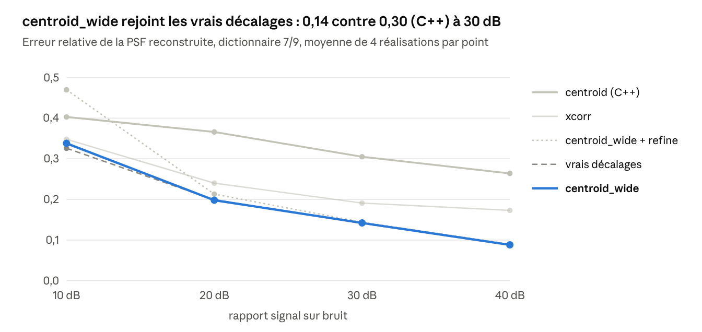

# Décalages, prox, flux et nombre d'images

## Estimation des décalages

`centroid_wide`, l'estimateur par défaut, donne de 20 à 40 dB la même qualité de reconstruction que les vrais décalages, et divise l'erreur relative par 2 à 3 par rapport au centroïde du papier.

### Le problème

Le papier pondère le centroïde par une gaussienne de largeur σPSF, soit 0,5 à 0,7 pixel BR. Sur une PSF sous-échantillonnée, une fenêtre aussi étroite se verrouille sur la grille des pixels : même sans bruit, le rapport entre décalage estimé et décalage vrai varie de 0,7 à 1,1. L'erreur RMS atteint 0,21 à 0,25 pixel HR quel que soit le bruit. Or le modèle M et la première estimation reposent sur ces décalages.

### Options

| Option | Principe | Coût |
| --- | --- | --- |
| `centroid` | centroïde pondéré du papier, fenêtre σPSF | négligeable |
| `centroid_wide` (défaut) | même estimateur, fenêtre `wide_factor` × σPSF (2,5) | négligeable |
| `xcorr` | corrélation croisée avec l'image de référence, affinée au 1/100 de pixel par DFT (Guizar-Sicairos 2008), sur images seuillées | 10 ms |
| `shift_refine` | après une reconstruction, ajuste décalages et flux de chaque image sur la solution, puis relance | une reconstruction par tour |

Une autre piste a été testée puis écartée : ajuster les décalages sur la pile de Lanczos. Construite à partir d'images repliées, cette pile est fausse, et l'ajustement absorbe ses erreurs (décalages presque exacts dégradés de 0,001 à 0,08–0,10 pixel HR).

La largeur de fenêtre a été réglée sur 10 réalisations par niveau de bruit : un facteur 2 est le meilleur à 10–20 dB, un facteur 3 à 30–40 dB ; 2,5 reste à moins de 0,003 pixel HR de l'optimum de 20 à 40 dB (`validation/results/wide_factor.txt`).

### Résultats

Protocole : validation sur données simulées, 4 images, dictionnaire 7/9, `-s 4 -N`, flux égaux non estimés, 4 réalisations par niveau de bruit (`validation/shifts_benchmark.py`).

| Méthode | Erreur RMS des décalages à 20 / 30 / 40 dB (pixels HR) | Erreur de FWHM à 30 / 40 dB |
| --- | --- | --- |
| `centroid` (papier) | 0,239 / 0,226 / 0,210 | 9,9 % / 2,5 % |
| `centroid_wide` | 0,027 / 0,007 / 0,004 | 6,1 % / 2,4 % |
| `xcorr` | 0,103 / 0,121 / 0,109 | 6,6 % / 1,4 % |
| `centroid_wide` + `shift_refine` | 0,066 / 0,011 / 0,010 | 6,2 % / 2,4 % |
| vrais décalages | 0 | 6,1 % / 2,5 % |

- **`centroid_wide`** supprime le verrouillage sans coût ; à 30 dB, son erreur de décalage (0,007 pixel HR) n'a plus d'effet mesurable.
- **`xcorr`** est exact sur des images bien échantillonnées, mais garde un biais d'environ 0,11 pixel HR sur des images repliées.
- **`shift_refine`** n'apporte rien : image et décalages sont partiellement dégénérés, et la solution absorbe une partie de l'erreur. À 10 dB, il dégrade l'estimation (0,40 pixel HR).

## Prox d'analyse : adjoint exact

Le C++ calcule le prox d'analyse avec la reconstruction de la transformée au lieu de son adjoint. Avec la starlet, cette erreur laisse un fond positif étendu et multiplie l'erreur par 2 à 4 ; elle est corrigée par défaut pour la starlet.

**Cause.** Le FISTA dual qui calcule le prox exige l'adjoint Φᵀ. Pour la starlet, la reconstruction est la somme des bandes, très différente de l'adjoint : l'opérateur calculé n'est plus le prox de la norme d'analyse, et il laisse passer une composante basse fréquence que la positivité redresse en fond positif.

**Diagnostic** sur `cube_test.fits` (starlet, `-s 4 -N`, `validation/results/starlet_background.txt`) :

| Variante | Fond / pic | Somme de la solution | χ²/N | Itérations |
| --- | --- | --- | --- | --- |
| Reconstruction à la place de l'adjoint (C++) | 8,2×10⁻³ | 0,362 | 1,42 | 50 (non convergé) |
| Échelle grossière pénalisée en plus | 7,7×10⁻³ | 0,343 | 1,38 | 50 |
| Adjoint exact (retenu) | 2,4×10⁻⁵ | 0,032 | 0,98 | 27 |
| Dictionnaire 7/9, pour comparaison | 2,8×10⁻⁵ | 0,033 | 0,98 | 30 |

**Effet sur les données simulées** (4 images, 4 réalisations par niveau, `-N`, `validation/results/adjoint_benchmark.txt`), en erreur relative / erreur de FWHM :

| Dictionnaire, prox, κ | 10 dB | 20 dB | 30 dB | 40 dB |
| --- | --- | --- | --- | --- |
| Starlet, reconstruction (C++), 4 | 0,827 / 13,4 % | 0,754 / 4,1 % | 0,320 / 5,3 % | 0,168 / 2,1 % |
| Starlet, adjoint exact, 4 | 0,339 / 8,3 % | 0,193 / 3,3 % | 0,147 / 5,2 % | 0,090 / 2,2 % |
| Starlet, adjoint exact, 5 | 0,294 / 8,9 % | 0,185 / 3,7 % | 0,149 / 5,0 % | 0,091 / 2,1 % |
| 7/9, reconstruction (C++), 4 | 0,338 / 12,7 % | 0,198 / 4,6 % | 0,141 / 6,1 % | 0,088 / 2,4 % |
| 7/9, adjoint exact, 2 | 0,339 / 11,7 % | 0,208 / 5,4 % | 0,159 / 7,1 % | 0,094 / 2,5 % |
| 7/9, adjoint exact, 4 | 0,376 / 15,6 % | 0,238 / 7,4 % | 0,177 / 7,4 % | 0,103 / 2,5 % |

- **Starlet** : l'adjoint exact divise l'erreur par 2 à 4 de 10 à 30 dB ; la starlet corrigée égale la 7/9 de 20 à 40 dB et fait mieux à 10 dB.
- **7/9** : l'adjoint exact y est légèrement moins bon, quel que soit κ entre 2 et 4 ; l'opérateur du C++ n'est pas un vrai prox mais fonctionne mieux avec ce dictionnaire, pour une raison non élucidée.
- **Défaut** : adjoint exact pour la starlet, reconstruction pour la 7/9 (`exact_adjoint=None`). `--prox-backprojection adjoint|recons` force l'un ou l'autre.

## Estimation des flux

Une variation de flux entre poses inférieure à environ 3 % (écart type) peut être ignorée. Au-delà, il faut estimer les flux par ajustement avec 3 réajustements, qui rattrape entièrement des variations d'au moins ±50 %, ou fournir les flux connus.

### Méthodes

- **Flux supposés égaux** (défaut, sans `-F`).
- `--flux-method aperture` : intégrale dans un disque de rayon 4 σPSF (2 à 3 pixels BR) centré sur le centroïde, méthode du papier (ouverture recentrée). La fraction de flux captée dépend de la phase sous-pixel de l'étoile.
- `--flux-method fit` : ajustement linéaire sur la première estimation. Avec mk = D Hk x⁽⁰⁾, le flux optimal a une forme close, fk = ⟨yk, mk⟩ / ⟨mk, mk⟩ sur les pixels valides : une photométrie par ajustement de PSF, qui tient compte de la phase.
- `--flux-refine N` : les flux sont réajustés N fois par la même formule sur la solution, à décalages fixes, chaque réajustement étant suivi d'une reconstruction.
- `--fluxes fichier` : flux connus (temps de pose, moniteur de source), prioritaires sur l'estimation.

La première estimation empile les images ramenées au flux de la référence ; le C++ empilait les images brutes.

### Variation tolérable ou rattrapable

Mesure sur données simulées : 16 images, starlet, `-s 4 -N`, flux uniformes dans [1 − d, 1 + d], 3 réalisations (`validation/flux_tolerance.py`). Valeurs à 30 dB : erreur relative / erreur RMS des flux.

| Écart type des flux | Flux supposés égaux | Ajustement + 3 réajustements | Flux vrais |
| --- | --- | --- | --- |
| 0 % | 0,059 / 0 % | 0,060 / 2,0 % | 0,059 |
| 1,2 % | 0,057 / 1,1 % | 0,058 / 2,4 % | 0,057 |
| 2,9 % | 0,065 / 2,7 % | 0,063 / 0,9 % | 0,062 |
| 5,8 % | 0,064 / 5,7 % | 0,061 / 2,6 % | 0,060 |
| 11,5 % | 0,081 / 12,3 % | 0,060 / 2,1 % | 0,058 |
| 28,9 % | 0,160 / 25,3 % | 0,058 / 1,4 % | 0,057 |

À 20 dB, les conclusions sont les mêmes (erreur relative de 0,103 à 0,164 pour les flux supposés égaux, de 0,104 à 0,121 avec l'ajustement, de 0,103 à 0,121 avec les flux vrais).

- **Jusqu'à environ 3 %** d'écart type, ignorer les flux ne coûte rien de mesurable ; les estimer ajoute une erreur de 1 à 2 % sur les flux, sans gain.
- **De 6 à 12 %**, les ignorer dégrade nettement la reconstruction (jusqu'à +40 % d'erreur relative) ; l'ajustement ramène au niveau des flux vrais.
- **Jusqu'à 29 %** (±50 %), l'ajustement rattrape entièrement l'écart, avec des flux justes à environ 2 %.

### Nombre de réajustements

Avec la 7/9 et des flux de ±20 % (30 dB, `validation/results/flux_benchmark.log`), les réajustements convergent progressivement :

| Images | Réajustements | Erreur sur les flux | Erreur relative | Erreur de FWHM |
| --- | --- | --- | --- | --- |
| 4 | 0 / 1 / 3 / 5 | 4,8 / 4,4 / 3,8 / 3,5 % | 0,106 / 0,103 / 0,099 / 0,098 | 2,7 / 2,5 / 2,3 / 2,1 % |
| 16 | 0 / 1 / 3 / 5 | 8,2 / 5,5 / 2,8 / 1,6 % | 0,065 / 0,061 / 0,058 / 0,057 | 3,7 / 2,3 / 1,3 / 0,8 % |

Trois réajustements suffisent dans les cas testés ; chacun coûte une reconstruction. L'ouverture n'apporte rien par rapport à l'ajustement et dégrade la FWHM ; elle reste disponible comme méthode du papier.

## Nombre d'images

Avec de nombreuses poses de la même étoile, la reconstruction devient très précise, pour un coût linéaire en nombre d'images (flux égaux, `-s 4 -N`, 2 réalisations, `validation/results/many_frames.txt`) :

| Dictionnaire | SNR | 4 images | 16 images | 50 images | 100 images |
| --- | --- | --- | --- | --- | --- |
| Starlet | 20 dB | 0,208 / 7,7 % | 0,108 / 0,2 % | 0,080 / 0,1 % | 0,069 / 0,1 % |
| Starlet | 30 dB | 0,151 / 5,2 % | 0,055 / 0,1 % | 0,036 / 0,1 % | 0,028 / 0,1 % |
| 7/9 | 20 dB | 0,194 / 8,1 % | 0,100 / 0,1 % | 0,074 / 0,1 % | 0,065 / 0,1 % |
| 7/9 | 30 dB | 0,147 / 6,2 % | 0,051 / 0,1 % | 0,034 / 0,1 % | 0,027 / 0,1 % |
| Temps, starlet / 7/9 | | 2 / 6 s | 3,5 / 6,5 s | 7 / 10 s | 13 / 16 s |

Valeurs : erreur relative / erreur de FWHM ; temps mesurés sur une machine partagée. Passer de 4 à 16 images divise l'erreur relative par 2 à 3 et supprime l'erreur de FWHM ; au-delà, le gain se poursuit plus lentement. Avec 100 poses, le facteur de sur-échantillonnage 2 est largement contraint : un facteur 3 (`-r 3`) devient envisageable, mais n'a pas été testé.
