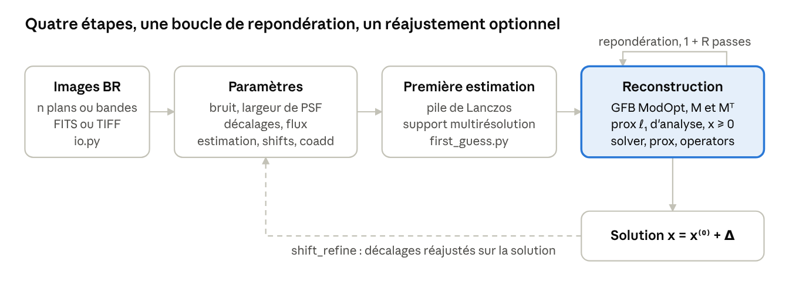

# Implémentation et contrôle du portage

## Implémentation Python

Le paquet `sprite-psf` reprend la structure de l'algorithme 2, avec un module par brique ; seul l'algorithme d'optimisation est délégué à ModOpt.

| Module | Rôle | Équivalent C++ |
| --- | --- | --- |
| `io.py` | lecture FITS et TIFF, cartes de pixels défectueux, écriture, fond de bord | `io_3d_read_data` |
| `wavelets.py` | starlet, 7/9 non décimée (transformée, reconstruction, adjoint), MAD iSAP | `MR_Trans`, `SB_Filter`, `get_sigma_mad` |
| `operators.py` | noyaux de Lanczos, M et Mᵀ par FFT, rayon spectral | `sprite_op_mat`, `sprite_transp_op_mat`, `spectral_rad_est` |
| `estimation.py` | bruit, centroïdes, flux (ouverture et ajustement) | `noise_est`, `compute_centroid`, `flux_est` |
| `shifts.py` | estimateurs de décalage, réajustement sur un modèle | `shift_est` |
| `masking.py` | pixels saturés (censurés) et défectueux (exclus), interpolation harmonique | (aucun) |
| `coadd.py` | largeur de la PSF : co-addition iSAP puis ajustement gaussien | `lr_psf_size`, `coadd_frames` |
| `first_guess.py` | shift-and-add de Lanczos, filtrage par support multirésolution | `mod_gen_2`, `mr_support_filt` |
| `prox.py` | prox ℓ₁ d'analyse pondéré (FISTA dual), contrainte Δ ≥ −x⁽⁰⁾ | `wl_filter_analysis`, `ineq_cons` |
| `solver.py` | algorithme 2, configuration, réajustements | `Sprite::min2`, `do_it` |
| `bayer.py` | mosaïque de Bayer : découpage par sous-réseau, décalages communs, une reconstruction par bande | (aucun) |
| `metrics.py` | FWHM, ellipticités, comparaison de PSF | (aucun) |
| `diagnostics.py` | contrôles sur données réelles, monochromes et Bayer | (aucun) |
| `parallel.py` | répartition des reconstructions indépendantes sur plusieurs processus | (aucun) |
| `cli.py` | commandes `sprite-psf` et `sprite-psf-check` | `run_sprite` |



Les paramètres sont estimés une fois sur les images BR. La reconstruction enchaîne la première passe et les passes repondérées ; en option, flux ou décalages sont réajustés sur la solution avant une nouvelle reconstruction.

### Optimisation avec ModOpt

La classe `GenForwardBackward` de ModOpt 1.7 implémente exactement l'itération de Raguet et al. utilisée par le C++ : même variable z<sub>i</sub>, même facteur γ/ω<sub>i</sub> passé au prox, même moyenne pondérée. Le portage lui fournit trois objets :

- **`SpriteGradient`** (`GradParent`) : résidu blanchi et gradient −Mᵀ(z − M(x⁽⁰⁾ + Δ)), avec poids nul sur les pixels exclus et terme censuré sur les pixels saturés.
- **`AnalysisL1Prox`** (`ProximityParent`) : prox de l'ℓ₁ d'analyse. Il réestime les niveaux de bruit λ à partir du gradient courant, garde la variable duale d'un appel à l'autre (démarrage à chaud) et porte les poids de repondération.
- **`LowerBoundProx`** (`ProximityParent`) : projection sur Δ ≥ −x⁽⁰⁾.

Une sous-classe de `GenForwardBackward` ajoute le critère d'arrêt à fenêtre glissante : arrêt quand la moyenne de Σ|Δ<sub>n+1</sub> − Δ<sub>n</sub>| sur 25 itérations passe sous 0,005 × Σ|Δ<sub>n</sub>|. Les variables z<sub>i</sub> sont conservées entre les passes de repondération.

### Choix d'implémentation

- **Transformées** : réécrites en numpy ; chaque filtrage 1D est une matrice mise en cache, appliquée par produit matriciel. Elles reproduisent les conventions iSAP (bord constant pour la starlet, bord miroir et filtres normalisés en ℓ₁ pour la 7/9, ordre des bandes). Chacune fournit sa reconstruction et son adjoint exact, bords compris.
- **Convolutions** : par FFT, sur une grille périodique, avec un noyau normalisé à une somme unité et centré sur N/2, comme `psf_convol`. Le test d'adjoint ⟨Mx, y⟩ = ⟨x, Mᵀy⟩ tient à 10⁻¹⁵.
- **Médiane** : la médiane inférieure d'iSAP pour un effectif pair, qui compte pour le MAD et pour la pile d'images.
- **Orientation** : le C++ travaille sur les images transposées ; le portage travaille dans l'orientation naturelle des tableaux, et les décalages sont notés (dy, dx).
- **Précision** : float64 partout, contre float32 en stockage dans le C++.
- **Parallélisme** : les reconstructions indépendantes (bandes d'une mosaïque, blocs de la prédiction croisée, moitiés, valeurs d'un balayage) sont réparties sur des processus (`concurrent.futures`), chacun limité à un thread de calcul numérique pour éviter la sur-souscription des cœurs. Option `-j` (défaut : cœurs moins un) ; `-j 1` exécute tout dans le processus courant. Les résultats sont identiques à l'exécution séquentielle. Une reconstruction seule n'est pas parallélisée.
- **Code** : toutes les fonctions et classes sont typées (`numpy.typing`) et documentées par des docstrings au format numpy, en français (paramètres, retours, exceptions, formes des tableaux).

Deux écarts volontaires au C++ subsistent, sans effet pratique :

- **Rayon spectral** : la méthode de la puissance part d'un vecteur numpy à graine fixe au lieu de `rand()`, d'où un écart relatif de 7×10⁻⁵.
- **Largeur de la PSF** : elle est ajustée par moindres carrés au lieu du schéma de Newton alterné, d'où un écart relatif de 1,1×10⁻⁴ et un effet de 2×10⁻⁵ pixel sur les centroïdes.

Temps de calcul : environ 2 s en starlet et 6 s en 7/9 pour 4 images de 84 × 84 (solution 168 × 168), contre 6 s et 24 s pour le C++ ; le temps croît ensuite linéairement avec le nombre d'images (environ 15 s pour 100 images).

## Contrôle du portage

En mode de rétrocompatibilité, le portage reproduit le binaire C++ à 10⁻⁶ près sur la solution finale, et chaque étage intermédiaire est vérifié séparément ; 71 tests automatiques couvrent le portage et les évolutions, soit 97 % des lignes du paquet (les lignes non couvertes sont surtout des messages d'erreur).

### Référence C++

Le script `reference/build_reference.sh` recompile le code d'origine sur macOS dans une copie, avec trois correctifs de compilation sans effet numérique :

- dialecte C++98 et OpenMP via libomp ;
- setters `std::complex` dans un lecteur FITS que SPRITE n'utilise pas ;
- renommage d'une variable globale en conflit avec `std::transform`.

Il exécute ensuite les deux configurations du papier sur `cube_test.fits` (`-t 2` et `-t 24`, avec `-s 4 -r 2 -F -N`). Un programme d'export (`dump_ref.cc`), lié aux bibliothèques d'origine, écrit les résultats intermédiaires. Deux reconstructions complètes produisent des fichiers identiques bit à bit (103 fichiers, vérification MD5).

### Écarts mesurés au C++

| Étage | Écart max relatif |
| --- | --- |
| Starlet et 7/9 : coefficients et reconstruction | ≤ 2×10⁻⁷ |
| Convolution, décimation, opérateurs M et Mᵀ | ≤ 2,5×10⁻⁷ |
| Bruit, centroïdes, flux, co-addition | ≤ 6×10⁻⁷ |
| Première estimation x⁽⁰⁾ | 3,5×10⁻⁷, supports identiques |
| Solution finale, starlet et 7/9, valeurs C++ injectées | ≤ 1,1×10⁻⁶ |
| Solution finale, pipeline Python autonome | 8×10⁻⁵ |

Ces écarts correspondent à la précision float32 du C++. La ligne « valeurs injectées » fixe le rayon spectral et la largeur de la PSF à ceux du C++, pour isoler l'algorithme ; la ligne autonome inclut les deux écarts volontaires.

Les autres tests couvrent :

- la reconstruction parfaite et l'adjoint exact des transformées ;
- l'identité d'adjoint de M ;
- le recalage des images par la pile corrigée ;
- l'égalité des flux d'une même source placée à différentes phases, et l'ajustement exact des flux ;
- la lecture des formats TIFF et FITS ;
- la précision des estimateurs de décalage ;
- les masques : deux jeux de données qui ne diffèrent que sur des pixels exclus donnent exactement la même solution ;
- l'absence de fond avec la starlet corrigée ;
- l'outil de contrôle sur données réelles et le balayage de paramètres ;
- la mosaïque de Bayer : découpage, convention des sous-réseaux, décalage chromatique retrouvé, réajustement exact des décalages sur les PSF vraies, options (fond, pixels défectueux, flux, motif BGGR) ;
- les options du solveur (réajustements, `xcorr`, flux par ajustement, flux et décalages imposés) ;
- la ligne de commande : toutes les sorties de `-W`, `-S`, `--bayer`, `sprite-psf-check` et `--scan`.

### Validation sur données simulées

Le script `validation/synthetic.py` suit le protocole du papier (section 4) :

- **PSF** : pupille obscurcie (30 %), araignée à trois branches et aberrations de bas ordre aléatoires, échantillonnée à 2 × 0,688 × Nyquist sur 168 × 168 pixels.
- **Images BR** : copies décalées par une rampe de phase exacte dans la pupille, puis décimées d'un facteur 2. Le modèle de simulation diffère ainsi de celui de SPRITE, ce qui évite le crime inverse.
- **Bruit** : bruit blanc gaussien, de niveau fixé par le rapport signal sur bruit en dB défini ci-dessous.
- **Métriques** : erreur relative ‖x̂ − x‖/‖x‖ après normalisation en flux, erreurs absolues sur les ellipticités e₁ et e₂ (moments pondérés, éq. 27–29), erreur relative de FWHM (ajustement d'une lorentzienne modifiée).

Les simulations n'incluent ni la réponse du pixel, ni le bruit de photons de l'étoile. Les résultats chiffrés de ce document en dépendent ; la validation sur données réelles reste à faire (voir « [Mise en œuvre sur données réelles](donnees-reelles.md) »).

### Rapport signal sur bruit en dB

Les niveaux de bruit (10, 20, 30, 40 dB) suivent la définition du papier (section 4.2). C'est un rapport signal sur bruit en échelle logarithmique, mais un rapport de **variances**, avec un « signal » particulier :

```math
\mathrm{SNR}_{\mathrm{dB}} = 10 \log_{10} \frac{\operatorname{Var}\left(x_{\mathrm{HR}}\ \text{sur 50 × 50 pixels autour du lobe central}\right)}{\sigma^2}
```

- **Signal** : la variance empirique de la PSF HR vraie dans une fenêtre de 50 × 50 pixels HR centrée sur le pic. Ce n'est ni le pic ni le flux de l'étoile.
- **Bruit** : σ², la variance du bruit blanc ajouté à chaque image BR ; il représente ensemble le bruit de lecture, le bruit du fond et, en première approximation, le bruit de photons.
- **Échelle** : 10 log₁₀ d'un rapport de variances, soit 20 log₁₀ d'un rapport d'écarts types ; +20 dB divisent σ par 10.

**Interprétation.** Un faible SNR en dB correspond à une étoile faible devant son bruit : étoile peu lumineuse, ou fond et bruit de lecture importants. Un SNR élevé correspond à une étoile lumineuse devant un bruit modéré. Seul compte le rapport : une étoile faible sur un fond très calme et une étoile brillante sur un fond bruité peuvent avoir le même SNR. Dans un détecteur réel, le bruit de photons de l'étoile croît avec son flux : doubler le flux ne double pas le rapport, et le bruit n'est plus uniforme (plus fort au cœur), ce que les simulations ne représentent pas.

La fenêtre de 50 × 50 pixels contient surtout du fond : sa variance est faible devant le carré du pic, si bien que ces dB sous-estiment fortement les rapports signal sur bruit usuels en astronomie. Équivalences pour les PSF simulées (moyenne sur 10 PSF, `validation/results/masking_and_snr.txt`) :

| SNR (dB) | Pic / σ dans une image BR | SNR en filtre adapté, une image | SNR en filtre adapté, 4 images |
| --- | --- | --- | --- |
| 10 | 77 | 85 | 169 |
| 20 | 243 | 268 | 536 |
| 30 | 768 | 847 | 1 693 |
| 40 | 2 430 | 2 677 | 5 355 |

Le SNR en filtre adapté est √(Σ y²)/σ sur les pixels de l'image sans bruit : c'est le SNR d'une photométrie par ajustement de PSF optimal. Même 10 dB correspondent donc à une étoile brillante (pic 77 fois au-dessus du bruit). Une étoile de SNR intégré 50 à 100 se situe vers 5 à 10 dB, sous la plage testée.

### Erreurs du C++ corrigées

La comparaison au binaire d'origine, étage par étage, a mis au jour quatre erreurs du code C++. Elles sont corrigées par défaut ; les options de rétrocompatibilité (voir « [Rétrocompatibilité avec le C++ publié](utilisation.md#rétrocompatibilité-avec-le-c-publié) ») les reproduisent une à une.

1. **Recalage de la première estimation** (`lanczos_stacking`) : chaque image est rééchantillonnée au décalage opposé et sur l'axe permuté. Sur `cube_test.fits`, l'erreur de recalage atteint 0,9 pixel BR ; comme la parcimonie porte sur Δ = x − x⁽⁰⁾, elle biaise directement la solution.
2. **Ouverture de flux** (`flux_est`) : des indices de pixels comptés à partir de 0 sont comparés à des centroïdes comptés à partir de 1 ; l'ouverture est décalée d'un pixel sur chaque axe, soit 1,4 pixel en diagonale pour un rayon de 2 à 3 pixels.
3. **Critère d'arrêt** (`min2`) : la moyenne glissante retire un élément encore présent dans la fenêtre, et le tampon n'est pas remis à zéro entre les passes.
4. **Prox d'analyse** (`wl_filter_analysis`) : la reconstruction de la transformée remplace son adjoint dans le calcul dual. Corrigé pour la starlet ; conservé pour la 7/9, où il donne de meilleurs résultats.

Deux autres défauts du C++ sont sans incidence sur les résultats : `noise_est_trace` est écrit hors limites, et le chemin du fichier `lr_` est construit sans séparateur.
